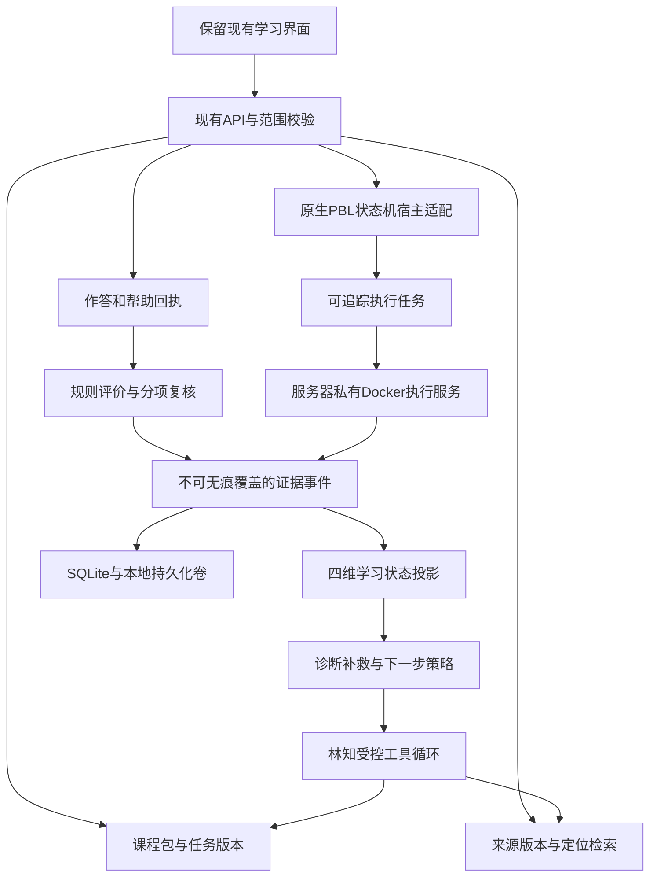

# 知行伴学：后端补全与 Linux 竞赛交付实施方案

> 2026-11-06更新：本文保留为历史差距清单。用户明确本次是竞赛交付，当前工作范围与优先级以[竞赛执行方案](竞赛后端落地与数据接入实施方案_20261106.md)为准。本文中的三组对照、完整任务平台及大规模表结构不再列为赛前强制项。可复核的当前事实见[11月6日审计](实施方案附件/后端现状审计_20261106.json)；此前在线检查不表示服务此刻在线。

编制日期：2026-11-05，时区 Asia/Shanghai。最终提交日期：2026-11-10，具体截止时刻尚未提供。参赛团队3人，代码、自动化测试、文档及部署准备由Codex承担；不把3名成员换算成3个并行开发岗位。

本方案解决的问题：在保留现有跨学科网站与界面的基础上，把已存在的数据保存和AI辅导升级为能够根据学习证据选择下一步、能实际验证、可以在Linux服务器复现的比赛系统。

## 一、先回答：后端到底写到哪里了

**后端已经实现并有真实写入，但完整的个性化学习业务尚未全部实现。** 当前属于“可运行的单用户应用骨架＋初步学习证据链＋PBL流程适配”，不是只有前端的静态样机，也不是原研究方案中的全部能力已经完成。

这里要区分四件事：

| 问题 | 本轮核查结论 |
|---|---|
| 是否有实际后端代码和API | 有。静态核查到34条应用API；另有部署用私有执行服务代码 |
| 用户操作是否能够真正保存 | 有。SQLite有20张表；目标、作答、帮助、资料、笔记、对话、记忆、PBL产物等有真实保存逻辑 |
| 研究方案是否全部实现 | 没有。诊断—补救—复核策略、完整多维状态、主观复核、延迟复习、公平对照等仍有明显缺口 |
| 能否声称服务器完整运行验收 | 不能。Linux部署包已准备，Docker执行尚未在目标服务器实测；完整OpenMAIC平台没有整体部署 |

本轮只读检查时，正式库有3个学习目标、2条消息、2次打开任务的运行上下文、0次提交作答、0个PBL学习实例。目标不是学生人数，消息不是有效学习样本；作答和PBL记录为0，也不等于保存接口没写，而是没有在正式库里进行相应学习操作。既往写入验收主要使用隔离QA库与临时数据库，不能把它们灌进正式库填满界面。

本轮读取 `/api/health` 与 `/api/pbl/catalog` 均为200；模式为 `local-single-user`，模型显示已配置，PBL目录有1个项目和7个阶段，执行服务为不可用。这次没有重新收费调用模型，也没有改写正式学习数据。

54项测试是上一轮已保存的工程验收结果，本轮同时核查了54个测试函数及其覆盖范围；它不代表54名学生试用，不证明真实代码容器已运行，更不代表学习效果已经验证。

## 二、报告如何采用：历史依据与当前状态分开

| 资料 | 在本方案中的作用 | 不能据此直接推断 |
|---|---|---|
| 《LearnLM与EduClaw-Bench数据扒取》 | 教学行为观察表、纵向评测与帮助条件设计 | 本产品已经复现论文结果、具备相同可靠性 |
| 《教育Agent个性化学习痛点深度研究》 | 识别持续使用、评价、学生状态和信任缺口 | 市场规模足以证明需求，或所有旧结论均已再次核实 |
| 《教育Agent参考项目拆解》 | 能力分层、受控Agent循环、分层练习、来源定位与任务回执 | 下载参考项目就等于已经合并它们的全部能力 |
| 《跨学科个性化学习Agent竞赛实施方案_20261102》 | 产品边界、证据语义及原始工作包 | 11月2日的“待实施”状态仍是11月5日现状 |
| 《开发任务与验收清单》 | 对照W01—W20逐项补缺 | 清单中的工作已经执行，或文档中的目标值是实测结果 |
| 《开工契约样例.json》 | 约定目标数据模型与服务端权威字段 | 其中示意API、四维状态已经存在于当前数据库 |
| 《方案结构校验记录.json》 | 证明原方案的篇幅、结构、链接与JSON示意做过检查 | 证明业务应用、服务器或教学效果已验收 |
| 《模型接口测试记录.json》 | 11月2日模型连通性记录 | 仅凭短回复OK证明工具调用、PBL或真实教学质量 |
| 《OpenMAIC分课程接入评估》 | 通用教学编排与编程PBL分层采用 | 其中接入前的“尚未实施”仍完整适用于后续代码 |
| 《Web交互逻辑与组件学习资源》《交互组件落地执行记录》 | 提交状态、校验、焦点、失败恢复与后端回执的联调标准 | UI按钮可点击就说明完整教育业务已完成 |
| 最新入口、重试、PBL验收记录 | 当前已实现能力的具体证据 | 把不同轮次58／28／16项浏览器检查相加成唯一总用例数 |

证据优先级：当前代码与只读运行状态 → 与同版本相符的最新验收记录 → 具体实施记录 → 接入评估 → 研究与原始规划。发现冲突时记录版本和日期，不用旧“未做”抹掉新实现，也不用新“已接入”覆盖尚未验证的运行环节。

研究中的论文规模不设为开发门槛：7,652道题、5,027条序列、865个KC、专家抽样数量等是特定实验配置。比赛冲刺不以追平论文数据量为目标，不把普通教学偏好分当成提分证据。本轮不重新使用旧报告中的市场金额、最高排名或“首次”等外部量化主张；如需写入答辩稿，应另行逐项核验。

《公开数据与授权来源清单》保留为候选来源目录。参赛不是商用项目，不按商业采购架构倒推开发；同时内容与代码仍按具体版本登记来源、许可和分发范围。未核实的资料不打包进提交物，不把某份论文的许可自动套到它引用的数据或其他课程上。

## 三、前端阶段性冻结，后端按能力对齐

现有视觉、导航、图片、林知形象、课程卡片和知识庭院保留。后续允许的前端工作限于接口联调、必要的状态说明、分项反馈与复核入口；不再进行全站重绘或换框架。

| 前端功能 | 已有后端基础 | 仍需补齐的业务 |
|---|---|---|
| 网站入口与示例 | 只读示例、确认后创建／恢复目标 | 示例与保留评测题的暴露边界继续校验 |
| 首页下一步 | 根据已有目标和局部记录生成前端规则建议 | 推荐策略迁到后端，给出证据ID、策略版本和原因 |
| 我的学习与路线 | 目标保存，模型生成草案，版本确认 | 诊断结果绑定能力目标；按新证据调整路线并保留旧版 |
| 课程广场 | 3份原创课程、9个单元、18项任务 | 可发布课程包、来源登记、题族、诊断与补救任务 |
| 知识图谱 | 已保存目标、显式课程关系、确认路线与作答证据 | 可观察能力组件、多种边类型、审核版本；跨科桥接证据 |
| 阅读与思考 | TXT／Markdown／粘贴资料、原文与段落定位 | 来源版本、稳定chunk ID、引用支持检查；PDF等后置 |
| 学习伙伴 | 真实模型、局部状态、检索工具、明确偏好与已确认记忆 | 结构化教学动作、取消、持久任务、可解释策略选择 |
| 灵感笔记 | 增删改、归档恢复、重试去重 | 普通笔记的引用版本与修改历史，避免旧引用指向新文本 |
| 阅读开放题 | 原始作答、公开标准、待复核 | 分项候选评价、引用证据、人工复核与纠正日志 |
| 纸桥实践 | 真实填写的阶段记录，关联笔记 | 多子目标验收、观察与解释分开、共同产物评价 |
| 编程PBL | 真实上游domain状态机、保存版本、审阅门禁 | Linux真实执行、超时／恢复验收、过程报告与运行任务台账 |
| 动态与设置 | 保存事件、全局偏好、JSON／Markdown导出 | 长期事件分页、状态重建、备份恢复实测与运行指标 |

知识庭院中的分类连接、课程发布顺序、显式先修关系、跨学科迁移关系必须继续区分。当前“来源真实”值得保留，但不把它称为完整的全学科KC系统。模型提出的新关系先作为候选；课程排序也不能自动变成先修定律。

## 四、11月10日前的交付目标

比赛版本要能演示并复现以下主链：

**提出学习目标 → 依据明确的材料与诊断 → 保存学习证据 → 选择对应的讲解／补救 → 使用未泄露的新任务复核 → 更新状态 → 重开后接着学习。**

跨学科不是三个聊天标签。数学采用可计算的判定，阅读采用论证rubric与复核状态，编程采用程序推理或真实隔离运行；它们共享证据结构，评价标准分别成立。

首批重点验收每门课至少一个代表性目标，其他现有单元继续可访问，自定义跨学科入口保持开放。重点验收范围不构成对产品输入的学科限制。

| 交付主线 | 具体要求 | 禁止替代 |
|---|---|---|
| 数学 | 区分百分比基准量；不同错误触发不同补救 | 只输出标准答案或换个称呼 |
| 程序学习 | 区分累加、覆盖与计数；项目有保存与运行证据 | AST检查、模型解释冒充执行通过 |
| 阅读 | 区分事实、评价与推断；反馈指出原文与作答依据 | 模型说“很好”直接授予掌握 |
| 跨科综合 | 同一问题分别使用数量、程序和表达证据 | 一科通过就给所有相关能力打勾 |
| 持续学习 | 恢复实际目标、最近证据、未完成任务和下一步 | 预填学习天数、假对话、假成绩 |

明确后置：自训KT、大规模自动KC抽取、视频ASR、多模型评委、完整OpenMAIC课堂生成平台、多租户机构系统和长期提分研究。这些不是产品永远不做，而是不作为本次冲刺的完成前提。

## 五、后端实现结构：沿现有工程增量升级

继续使用Vue3、FastAPI、SQLite与现有模型适配。比赛单机不因未来扩展预先增加Redis、Neo4j、大型向量库或多套编排框架。SQLite不是多用户能力的证明，但可以承接当前受控单机的版本与事件；实际并发和恢复以服务器测试判断。

建议新增逻辑模块：`backend/content_registry.py`、`backend/evidence.py`、`backend/learner_state.py`、`backend/teaching_policy.py`、`backend/assessment.py`、`backend/review_service.py`、`backend/jobs.py`、`backend/migrations/`。具体可合并为少量文件，不为目录数量拆微服务。现有 `service.py`、`agent.py`、`knowledge.py`、`pbl/`逐步调用这些能力，旧API先保持兼容。

### 5.1 数据升级与迁移

保留已有20张表和实际记录。新增字段／表通过有版本号的迁移登记，迁移前做一致性备份，在旧库副本执行后核对计数与关键关联。不得删除正式库来“让新结构初始化成功”。

| 数据对象 | 首批字段与约束 | 与现有数据的关系 |
|---|---|---|
| `source_versions` | 来源、原文哈希、定位、许可记录、用途、版本 | 关联materials；已发布讲义单独登记作者与版本 |
| `source_chunks` | source_version、稳定chunk ID、章节／段落、文本 | 逐段可回原文，不索引答案契约 |
| `objectives` | 可观察目标、所属领域、KC标签、审核状态 | 从现有9个单元开始映射，按需要细化 |
| `objective_relations` | 边类型、方向、来源、审核者／状态、版本 | 保存先修、课程顺序、关联、桥接，不混用 |
| `task_versions` | 题面、目的、题族、目标映射、资源条件、私密契约引用 | 现有18项任务登记并冻结，不把答案放回客户端 |
| `assessments` | attempt、rubric／规则版本、状态、分项依据、是否作废 | attempts保留原始作答；评价可追加纠正记录 |
| `assessment_reviews` | 原评价、复核依据、操作者、旧／新结论、时间 | 复核不能无痕覆盖旧判定 |
| `learner_evidence` | 目标、证据类别、作用范围、来源ID、有效状态 | 关联作答、帮助、复核与项目产物 |
| `learning_state_projections` | 四维状态、rule_version、证据ID、更新时间 | 可由有效证据重建；旧标签兼容显示 |
| `next_actions` | 动作、原因、策略版本、证据、接受／跳过结果 | 不持久化模型臆测的“已掌握” |
| `review_schedule` | 目标、新任务版本、due_at、间隔规则、状态 | 延迟检查按真实时间，不能改时钟伪造保持 |
| `jobs`／`job_events` | 输入快照、请求标识、状态、执行ID、取消和结果 | 统一模型长任务与执行任务的恢复语义 |

旧数据缺少的维度标为 `unknown` 或 `not_checked`，不可从历史聊天倒推能力分数。`learner_scope`当前明确为单用户工作区；若以后增加评委独立账号或多个学生，再由宿主认证绑定身份，不能信任客户端自报的learner ID。

### 5.2 课程与任务包

先建立最小可验证规范，不以大量爬题替代内容质量。每个发布包必须有：包ID／版本、目标与适用基础、来源、公开材料、任务用途、题族、私密判定契约、提示分级、常见错因、补救映射和发布检查结果。

现有9个单元、18个任务继续保留。第一轮逐项检查三门代表目标；若扩充全部9单元，可分别增加诊断与补救任务，形成约36项候选任务，但这个数字只是工程容量估计，不是硬指标，未审核的任务不能为凑数发布。

任务目的至少区分 `diagnostic`、`practice`、`remediation`、`independent_review`、`delayed_review`。参数变化通常只支持同题族练习或近迁移，不能自动标为全新独立任务。公开示例与保留评测任务分离；浏览只读示例不写正式学习记录，正式确认开始后可登记该示例来源与已知暴露条件。

### 5.3 四维状态与更新

当前 `states()` 已从作答派生标签，但未实现原方案的完整四维对象。本轮补为：

- 覆盖：未涉及／部分讲解／已涉及。它只描述材料与教学活动。
- 表现：未观察／困难已观察／部分符合／符合该任务标准。
- 帮助：未知／受助／当前可观察范围内未受助。
- 保持：未检查／已安排／存在延迟任务证据。

例如“答对但看过提示”可以是：覆盖已涉及、表现符合、帮助受助、保持未检查。不能合并为“掌握100%”。

更新过程固定为：校验题目版本与上下文 → 保存原始作答及帮助快照 → 规则／rubric评价 → 保存证据和事件 → 重建目标状态 → 产生下一步候选。评价被撤销时追加失效事件，再重建投影，不直接给汇总标签减一个分数。

跨学科只共享能够说明机制的桥接证据。例如数学中的条件与Python条件分支存在相关性，不表示一边通过就自动通过另一边。不同目标有各自证据与置信边界。

### 5.4 教学策略与下一步

把首页和学习页的关键建议统一为后端策略输出，保留当前前端规则作为服务失联时的有限降级提示，并明确显示同步状态。建议结构包含：action、objective_id、task_version、reason、evidence_refs、policy_version、allowed_resources、expires_or_revision。

首批策略必须能做出不同决定：

| 观察证据 | 动作 | 防止误判 |
|---|---|---|
| 无作答、基础仅为自述 | 解释目的并提供诊断 | 自述不写成已验证能力 |
| 同类错误重复出现 | 给对应对比例子／反例，再补救 | 不无限重复同一定义或自动题海 |
| 受助后完成 | 换未暴露任务复核 | 受助成功不算独立掌握 |
| 当前独立任务符合标准 | 允许推进，并安排适当回看 | 当次表现不等于长期保持 |
| 工具失败、题面无效 | 修复环境或任务，保留能力未知 | 不计成学生知识错误 |
| 证据已足且用户想继续 | 认可并推进 | 不为凑轮次继续盘问 |
| 路线调整涉及多个目标 | 提出新草案，等待确认 | 不无提示覆盖已确认路线 |

每项建议引用真实记录，不展示内部思维链。模型可以提出动作和表达解释，服务负责校验可执行范围。需要给答案时按任务模式处理并记录帮助；合理求助不应受到惩罚。

### 5.5 开放题评价与复核

先完成“可追溯反馈”，再考虑更复杂自动评分。reading的每条rubric返回匹配的学习者原文片段、判据、候选结论和未确定项；引用片段必须能在原作答中定位。模型不能自行改成最终正式通过。

评价状态区分规则已核对、模型候选反馈、待人工复核、已复核、已纠正／作废。复核接口必须有宿主确认的维护权限；不能让学习者在请求里传 `reviewer=true` 就改成绩。若11月8日前无法完成权限与复核日志，保留待复核结果，不在比赛中演示未经保障的自动通过。

前端只需在现有作答反馈增加分项说明和复核状态；不另建一整套教学后台。三位参赛成员可以参与内部核对，但不能因此宣传“教育专家评审”。如果尚无真实审核者，就如实标注项目组自查或未复核。

### 5.6 PBL真实执行与报告

沿用已接入的OpenMAIC v1.4.0 domain状态机及现有角色边界。计划审阅、实现审阅是针对保存版本的建议；学习者的确认仍与实际测试结果分开。

Linux优先检查以下完整路径：未实现初始代码失败 → 保存计划与代码 → 审阅当前版本 → 显式确认 → 独立容器执行 → 宿主核对结果 → 测验 → 复盘。先故意制造错误，再验证通过，能排除“什么也没写却全绿”。

执行回执要绑定study、project_version、artifact_sha、run_id、评测规则版本和实际结束状态。超时、镜像未准备、Docker断开、结果未知与学生实现失败分别处理。旧通过只能说明旧版本；新增／修改源代码使依赖的结果与批准失效。

现有执行器代码使用私有Docker服务、本地数据卷和临时容器。本轮部署不需要新购E2B／S3。仍需在目标服务器验证权限、容器资源限制、超时清理、服务重启与文件恢复，不能以Python单元测试夹具代替。

过程报告先用确定性指标和真实事件：做过哪些选择、保存了哪些版本、实际测试过哪些版本、测验与复盘的状态。模型可生成有依据的文字摘要，但不能把历史通过认证到新代码，也不能从成品推断学生长期掌握。

### 5.7 任务、取消与恢复

保留已有提交去重。补充持久任务台账时，需要明确“未执行”“运行中”“成功”“失败”“已取消”“结果未知”。浏览器连接断开不等于后端已取消；发出取消后还要核对执行器状态，不能立即宣称停止。

每项外部执行先生成稳定ID，未知结果时先查旧任务，不新启动一份。模型超时后保留用户原问题与草稿；迟到结果可以留作历史，但不能覆盖当前目标、题目版本或产物。失败调用也进入时延与费用统计。

比赛单机可使用SQLite任务表及一个受控worker；是否引入队列由实测决定。预算至少包含单轮调用数、总时长、输出长度、并发和取消出口，不照搬上游某条教学链默认的无总次数限制。

## 六、新增／调整API契约

下表是待实施或待收敛的目标契约，不表示这些新接口目前已经存在。现有34条接口继续兼容；命名可以随实现调整，但职责与证据字段必须保留。

| 目标接口 | 用途 | 关键验收 |
|---|---|---|
| `GET /api/content-packs` | 已发布课程包与能力声明 | 草案与缺契约内容不冒充已发布 |
| `GET /api/objectives/{id}` | 目标、前置和来源 | 关联版本明确，无依据关系不自动跳课 |
| `POST /api/sessions/{id}/diagnostics` | 开启对应诊断 | 同请求恢复同一任务，不泄漏答案 |
| `GET /api/sessions/{id}/learning-state` | 四维状态与证据 | 旧数据未知；同证据同投影 |
| `GET /api/sessions/{id}/next-actions` | 下一步建议及原因 | 服务端可解释，来自实际证据 |
| `POST /api/sessions/{id}/next-actions/{action}/decision` | 接受、跳过或暂缓 | 不把跳过记为学会 |
| `GET /api/attempts/{id}/assessments` | 当前及历史评价 | 原始作答与评价版本分别保存 |
| `POST /api/assessments/{id}/review` | 授权复核与纠正 | 无维护权限拒绝，旧评价不无痕覆盖 |
| `GET /api/reviews/due` | 到期复核 | 使用真实时间和独立任务条件 |
| `GET /api/jobs/{id}` | 状态与结果回执 | 返回执行ID、作用范围、终态／未知 |
| `POST /api/jobs/{id}/cancel` | 有效取消与确认 | 取消后不复活，不能误取消另一任务 |
| `GET /api/pbl/studies/{id}/report` | 完成后的过程报告 | 只读不重新调用执行器，不提前伪造报告 |

写请求继续使用稳定请求标识；学习状态、评价结论和运行成功由服务器决定。不能通过前端传入答案、当前角色或 `passed=true` 覆盖。

## 七、按11月10日倒排的执行安排

所有编码、测试、文档与包构建任务默认执行者为Codex。团队不需要被分配虚构的开发分工。需要真实服务器访问、实际试用或报名提交时，由具备权限的成员提供条件或完成该行为，不能由AI冒充。

| 日期 | 当日优先完成 | 当日必须拿出的证据 |
|---|---|---|
| 11月5日 | 当前审计、功能与口径冻结；整理差距；固定数据迁移与课程包契约 | 当前状态表、审计JSON、明确阻断项与次日入口 |
| 11月6日 | 迁移／备份副本验收；三科代表目标与任务用途；Linux执行环境优先落地 | 旧库副本数据未丢；已审核包样例；服务器执行可用性结论 |
| 11月7日 | 四维状态、错因与补救策略、后端下一步；开放题分项候选反馈 | 不同证据产生不同动作；帮助与独立性不误标 |
| 11月8日 | PBL真实执行全旅程、任务恢复、最小复核与跨科桥接 | 错代码失败、正确版本通过、改后旧证据失效；真实回执 |
| 11月9日 | 冻结版本、回归和公平基线；备份恢复；提交包与演示彩排 | manifest、全量分母、失败案例、可复现视频与包一致 |
| 11月10日 | 按实际截止完成提交，仅修阻断缺陷 | 提交清单、包校验值、环境说明；不加大功能 |

不把表格当作无条件完成承诺。服务器可用性、内容审核与严重失败会影响范围；出现阻断时先关闭未验收能力、修正宣传口径，不能用预录成功日志或夹具结果填充实时运行。

11月9日计划冻结；若10日截止很早，应进一步前移最后打包时间。当前没有学校／赛区的具体时刻，不假定23:59，也不使用旧报告检索到的通用赛事日期代替用户确认的11月10日。

## 八、可以直接执行的后端工作包

| 编号 | 优先级／计划日 | 工作与主要改动位置 | 依赖 | 完成条件 |
|---|---|---|---|---|
| B00 | P0／11-05 | 审计代码、数据与报告，生成当前事实清单 | 无 | 已完成本轮只读核查，文档与业务证据分开 |
| B01 | P0／11-06 | `store.py`及迁移目录：版本迁移、备份恢复 | B00 | 旧库副本迁移后目标、作答、引用与关系不丢，恢复可核对 |
| B02 | P0／11-06 | 内容注册与私密契约：课程包、目标、题族、用途 | B01 | 三科代表任务可发布，答案／隐藏测试不可检索 |
| B03 | P0／11-06 | `knowledge.py`与来源服务：来源版本、chunk定位、引用 | B01 | 发布材料引用可回原位置；旧引用保持版本 |
| B04 | P0／11-07 | 学习证据与四维状态投影 | B02 | 帮助、无效题、待复核、独立表现与保持分别表达 |
| B05 | P0／11-07 | 教学策略与诊断／补救／复核；接回现有首页 | B03,B04 | 同目标不同证据至少触发两种不同且可解释动作 |
| B06 | P0／11-07—08 | rubric候选评价与最小授权复核 | B02,B04 | 片段来自原作答；没有复核就保持待复核 |
| B07 | P0／11-06—08 | `deploy/server`、runner：Linux实测 | 外部E1 | 故意错误会失败、正确代码会通过、超时与清理真实有效 |
| B08 | P0／11-08 | `backend/pbl`：运行台账、版本联动与过程报告 | B07,B04 | 当前源版本与检查一致；报告只读并可重开 |
| B09 | P0／11-07—08 | 持久任务、取消、重试、预算与迟到防护 | B01 | 未知不冒充成功，重复不双跑，取消不复活 |
| B10 | P0／11-08 | 一个跨科共同问题与桥接任务 | B02,B05 | 三种证据分别归属，不能互相冒充掌握 |
| B11 | P0／11-08—09 | 冻结用例、普通聊天基线、固定路线与策略比较 | B05,B06 | 同模型／资料／预算；失败进入分母 |
| B12 | P0／11-09 | 服务器运行模式、备份、来源隔离、访问范围 | B07,B09 | 按私有单机演示口径验收；公网另有认证门槛 |
| B13 | P0／11-09 | 清洁环境复现、彩排、固定包和演示版本 | B08,B10,B11,B12 | 另一清洁目录按说明可运行，包与视频一致 |
| B14 | P0／11-10 | 最终提交材料和阻断问题复查 | B13 | 已实现、目标值、夹具、模拟和未测明确标记 |
| B15 | P2／赛后 | PDF/OCR、视频ASR、自训KT、完整课堂生成与多用户平台 | 主线完成 | 有明确收益与资源后再单独立项 |

B00的“完成”不表示B01—B14已经执行。本轮是实施方案与差距审计，后续状态要以各工作包产物与验收记录更新。

## 九、冻结验收用例与公平对照

先按风险而非页面数量检查。现有54项后端测试继续保留；新增测试要验证业务语义，不能只测试“返回了200”或复制实现中的条件。

| 类别 | 必测用例 | 发布要求 |
|---|---|---|
| 数据恢复 | 旧库副本迁移、重启、备份恢复 | 已保存内容及版本可核对，无数据丢失 |
| 提交与帮助 | 响应丢失重试、提示送达／未知、同题暴露 | 不重复计次，不把未知当未受助 |
| 个性化 | 无证据、两种错因、受助成功、独立复核、用户跳过 | 动作不同且原因可回证据 |
| 开放题 | 合理替代表述、证据不足、错误rubric片段、复核纠正 | 候选与正式结论分开，不能凭空引用 |
| 图谱与来源 | 顺序与先修区分、候选边、改版、无来源 | 不编造节点关系，不把候选用于强制跳课 |
| 执行 | 空实现、正确实现、无限循环、超量输出、环境故障 | 对错及基础设施问题有明确区分 |
| 版本 | 改代码／计划后的旧审阅与旧通过、迟到回复 | 旧结果不认证新内容 |
| 取消恢复 | 切目标、取消、断线、服务重启、结果未知 | 不覆盖新上下文，不自动重复外部副作用 |
| 证据边界 | 初次表现、参数变式、桥接、延迟任务 | 不把近迁移与长期保持混报 |
| 访问范围 | 私密答案、不同目标范围、导出、部署目录 | 不泄漏隐藏契约或凭据 |

对照配置：B0为认真设计的普通聊天辅导，使用相同模型、同等必要材料／工具与预算；B1为固定路线加同样记录；B2为证据驱动策略。只有在差异来自待检验模块时才解释增量。目标不是选一个很差的聊天提示作陪衬。

先用自编且已审核的固定工程案例验证。报告动作正确数／总数、引用支持数／总数、误标独立数、重复副作用数、完成／失败／取消／未知数、时延与实际调用费用。内部测试可帮助定位问题，不写成真实学生学习增益。

LearnLM细则用于观察清晰度、是否重复、承认正确回答、反馈是否有助于自我发现等。EduClaw用于启发长周期情境与多轴检查；不复制论文一致率作为本系统准确率，不要求先训练KT模拟学生才能开工。

11月10日前不宣称已经验证长期提分。若安排真人体验，应说明是否项目组成员、是否看过题目、允许帮助、实际间隔与未完成样本。3名参赛成员不是自动成立的独立学习者实验；已经接触答案的人不进入保留任务的独立增益样本。

## 十、服务器演示与必要外部条件

已确定Linux（Ubuntu／Debian）单机路线。保留现有模型服务，服务器本地部署网站、API、私有执行服务与持久化数据卷；无需为比赛额外开通E2B／S3账户。

| 条件 | 用途 | 目前状态 |
|---|---|---|
| E1：已有服务器连接方式、权限与目标目录 | 安装／检查Docker、部署与真实运行 | 仅系统类型已确定，尚无连接信息与服务器验收 |
| E2：现有模型私有配置 | 服务端真实辅导 | 本机已配置且有历史实测；服务器配置尚需核对 |
| E3：实际提交入口与截止时刻 | 最终打包与提交 | 日期已确认为11月10日，时刻未提供 |
| E4：课程内容审核与真实试用条件 | 教学与效果范围 | 不默认存在教师或外部学生；可先做标注清楚的工程验收 |

需要提供凭据时只使用本机已有SSH别名、配置文件路径或服务器私有文件，不在聊天中发送密码、私钥或完整API Key。取得实际访问条件前可以完成代码、测试、包和脚本，但不能报告远程部署已完成。

默认127.0.0.1:8080加SSH隧道适合受控演示。若希望评委直接公网独立访问，应增加HTTPS、访问认证与身份绑定后再开放；当前 `local-single-user`不能宣称多人数据隔离。服务器任务有资源限额与数据备份，演示失败可返回已有记录，不能用静态成功日志替代。

## 十一、11月9日冻结和11月10日提交标准

冻结包至少包括：可启动源码／构建产物、固定依赖、私有配置样例、数据库迁移与备份恢复说明、审核课程包、来源清单、固定用例、运行manifest、失败案例、服务器验收结果、演示脚本与视频。包内不含密钥、私钥、正式个人记录或不能分发的原资料。

口径示例：

- 可以说：系统保存真实作答和帮助条件，并据此选择补救或新题复核。
- 需要相应新验收后再说：三种学科评价完成同一业务闭环，项目代码已在服务器隔离执行并可恢复。
- 当前不能说：已支持自动适配任意学科的完整课程、已部署完整OpenMAIC平台、已训练可靠跨科KT、已经证明提高学生成绩。

若B07未通过真实服务器验收，代码运行能力保持关闭并说明原因；数学、阅读或程序预测主线可以按已验收范围演示。若B05未形成根据证据区分下一步的决策，只能称“有学习记录的AI辅导”，不能把个性化当作已经完成的核心创新。

## 十二、当前证据定位与下一步

源码入口：`app/backend/main.py`、`store.py`、`service.py`、`knowledge.py`、`agent.py`、`teaching_profiles.py`、`backend/pbl/`；界面对应 `app/src/components/`。后续补充的API、表结构及聚合审计在 `实施方案附件/后端现状审计_20261106.json`，实际观测日期以该文件为准。

工程记录：`app/test-reports/pbl-v3-20261105/REPORT.md`、`entry-20261105/REPORT.md`、`entry-completion-20261105/REPORT.md`及对应JSON。本轮没有重新跑模型或把历史测试改写成新实测。

**执行起点是B01与B02，服务器条件具备时同步优先做B07。** 数据语义、内容与真正可执行的评价先稳定，再让Agent根据它们调整教学。现有界面继续消费同一套真实服务，而不是为每张页面另造一套后端。
