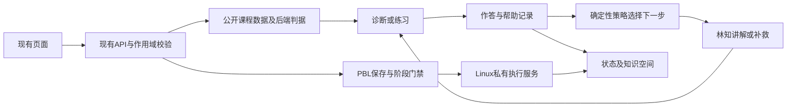

# 知行伴学竞赛交付执行方案

更新：2026-11-06。最终提交日：2026-11-10，具体截止时刻待提交入口确认。团队3人；编码、自动检查、文档和打包由Codex执行。本文替代11月5日方案中与当前竞赛冲刺不符的工作优先级。

一句话目标：**让评委在现有网站里，从一个跨学科学习问题出发，看到诊断、针对性帮助、实际作答或代码检查、知识空间更新，以及重新进入后继续学习的完整过程。**

验收围绕作品能否运行、操作是否闭环、结果是否有实际依据、出现故障能否恢复展开。论文训练、专家规模、统计显著性和长期干预研究不作为本次提交前提。下面的“检查”指软件功能验收；它仍然必要，例如按钮不能空跳转、答错不能显示已掌握、代码没有执行不能显示运行成功。

## 1. 当前后端结论

**已经有后端，也已经有真实保存；个性化教学主链和服务器代码执行尚未全部完成。** 不需要推倒前端或重建整个系统。

11月6日实际执行了源码静态检查和SQLite只读聚合检查，产物见[当前后端审计](实施方案附件/后端现状审计_20261106.json)。它记录34条应用API、20张业务表、54个现有后端测试函数。54是源码函数数量；既往测试通过记录另见应用内test-reports，本轮没有重新运行全部测试，也没有再次调用收费模型。

| 能力 | 当前事实 | 交付还差什么 |
|---|---|---|
| 课程和目标 | 已有3门课程、9个单元、18项任务；可创建自定义目标 | 候选课程包接入、诊断和补救任务选择 |
| 保存 | 目标、消息、作答、资料、笔记、帮助、记忆和PBL版本有真实存储逻辑 | 新规则所需的少量版本字段、迁移与恢复核对 |
| AI辅导 | 已有模型适配、受控工具、引用和失败处理 | 下一步从学习证据生成，避免只靠对话措辞 |
| 下一步 | 现有界面含前端建议规则 | 服务端输出动作、原因和依据，并供首页及学习页共用 |
| 学习状态 | 已区分若干作答及受助状态 | 明确表现、帮助条件和待复核，不能一律变成掌握 |
| 知识空间 | 来自保存资料、对话、确认记忆、课程结构及作答 | 补充新目标的实际来源和关系，候选跨科边单独标记 |
| 阅读开放题 | 保存原始答案、公开判据，保持待复核 | 分项反馈定位到原作答；无可靠复核时不自动判通过 |
| 编程PBL | 已适配OpenMAIC原生7阶段domain状态机，保存计划及代码版本 | Linux真实容器执行和完整恢复验收 |
| 部署 | 已有Linux单机部署脚本和部署包 | 实际服务器连接条件与运行验收 |

正式库当前有3个目标、2条消息、2次任务打开上下文、0条作答、0个PBL实例。这反映正式库实际使用情况；不把QA临时数据填进来制造活跃度，也不据此认定保存功能不存在。

本次审计访问本机8765端口的health和PBL目录未连通，记录为URLError。此前报告的HTTP 200属于此前运行时的检查，不能当成此刻服务在线。恢复开发时先使用现有启动脚本启动，再做接口联调；当前不把服务未启动解释为后端不存在。

## 2. 本次比赛的范围与完成标准

保留已有视觉和跨学科入口。三门课程用于展示不同的教学方式，不限制用户只能输入这些学科。任意问题可以进入目标讨论；具有正式任务与判据的课程才提供相应的自动判定，其他目标先使用资料和规划流程。

### 2.1 提交前必须完成

1. **一条真正会改变下一步的学习链。** 同一目标下，诊断答错进入对应补救，答对可进入后续任务；每项建议能回到真实作答或用户选择。
2. **三类课程各有合理反馈。** 数学检查计算与概念；程序阅读检查状态变化；阅读指出主张、证据和范围，开放答案保留分项候选结论。
3. **一个跨学科共同问题。** 同一份阅览室演示表能被用于计算占用率、理解程序汇总、讨论建议依据；各科结果分别保存。
4. **知识空间是实际内容。** 保存资料、讨论和确认记忆后能搜索、预览、打开原文、继续讨论；图谱显示对应来源，不虚构学习成绩。
5. **刷新、重开与重试可靠。** 已保存的内容保留，重复请求不产生重复业务记录，失败可重试，空状态有下一步入口。
6. **编程项目按实际环境展示。** Linux执行通过验收后开放真实代码运行；尚未实测时保留计划、代码保存和审阅能力，明确运行不可用。

### 2.2 本次不作为硬前置

不训练跨学科KT，不按每科数千题攒数据，不招募数百名专家，不跑30天模拟学生，不建设多租户学校平台，不整体搬入OpenMAIC全部服务，不新增视频转写流水线。PDF/OCR、笔记完整版本系统、统一异步任务平台、自动延迟复习调度、模型自动出整门课程也不阻塞11月10日提交。

长期保持先显示“尚未检查”；可提供用户选择的后续回看入口。不能为了演示改系统时间或把当天重做称为长期保持。更复杂的调度及收益研究赛后再做。

## 3. 已完成的数据补充及用途

本轮已实际生成[候选课程包](数据补充_20261106/README.md)，不是仅列下载网址。

| 内容 | 数量 | 当前状态 |
|---|---:|---|
| 原有任务导出 | 18 | 保留原题ID和版本，不重复写入正式库 |
| 新诊断任务 | 9 | 每个原有单元1项，待接入 |
| 新补救任务 | 9 | 每个原有单元1项，待接入 |
| 跨学科桥接任务 | 3 | 自编阅览室共同问题，待接入 |
| 候选任务总数 | 39 | 29项选择题、10项开放题 |
| 能力目标 | 12 | 9项原目标加3项桥接目标 |
| 候选错因卡 | 18 | 诊断错选项到补救任务；不是稳定人格判断 |
| 来源记录 | 22 | 自编内容、方法文献、官方参考链接、固定源码分别登记 |
| 关系记录 | 6 | 3条已有显式程序先修关系、3条候选跨科桥接 |
| 阅览室观察表 | 12行 | 明确为项目自编演示表，不是真实测量 |

已经执行216项结构、关联和隔离断言，全部通过；另有8项选定算术检查。检查说明见[候选包校验](数据补充_20261106/校验/候选包结构与隔离检查.json)。这不等于课程专家审核或所有题目完成教学效果验证。

公开目录只有题面、可公开判据、讲义和来源；参考答案、提示、解释及错选映射存放private目录。**整个候选包不得复制进public静态目录。** 需要提示时由后端按任务权限返回并记录帮助，不能从前端直接读取私有文件。

相近题按保守的exposure_group_id分组。特别是循环计数补救题与原复核题存在语义接近，阅览室两个计算题也能互相透露信息；它们适合练习及演示，不宣称相互独立。现阶段不以任务ID不同就授予“新情境迁移已掌握”。

### 3.1 为什么现在不继续大规模爬数据

目前缺口首先是题目如何进入流程、错误如何影响下一步、写入后如何反馈。现有39项候选任务已经足以承接本次主链。继续下载数千题会增加映射、去重、答案核查和页面适配成本，不能自动补上业务逻辑。

官方Python文档、OpenStax概念页和CMU rubric页面作为可追溯参考链接登记，没有宣称已下载整套教材或获得其中全部内容的再分发许可。论文方法资料默认不进入学习者知识库，避免把开发研究资料当作课程内容。

另已实际下载Python 3.12控制流、数据结构及许可页共3份HTML快照，保存获取时间、页面标题与SHA-256，见[下载清单](数据补充_20261106/来源快照/下载清单.json)。这些是真实官方资料，尚未接入运行时检索；与自编题及演示表分别管理。

## 4. 具体实现：在现有代码上补最小闭环

继续使用Vue3、FastAPI、SQLite与已有模型服务。单机比赛不增加Neo4j、Redis、向量数据库或另一个总控框架。图谱是现有业务数据的一种展示，底层不必因为有连线就换成图数据库。

### 4.1 课程包接入

第一版课程注册直接读取部署包内固定版本JSONL，不先做教研发布后台。添加一个很小的内容加载模块，负责校验ID、来源、任务用途和版本；已有content.py继续作为兼容入口。新增任务通过服务端任务目录访问，不能绕过当前run、attempt、session校验。

接入步骤：先在临时库加载候选包；检查原18题ID和版本未改变；将新诊断、补救、桥接任务加入服务端映射；由公开转换函数删除私有字段；将来源送入资料检索时只导入允许检索的公开讲义。整包通过检查后固定包哈希，再更新正式部署产物。

来源记录不直接等于可检索片段。论文及源码参考保持learner_retrieval=false；自编讲义可索引；答案契约始终不可索引。先沿现有段落定位实现，新增稳定source_id、版本与片段位置即可，不要求比赛前建设完整通用文档平台。

### 4.2 最小迁移

先用SQLite备份API做一致性备份，再在副本上验证迁移。保留原20张表及记录，不删库重置。

优先复用已有attempts、assistance、events、runs及PBL版本表。需要新增时，第一批只处理：迁移版本登记、任务包版本绑定、作答中的目标与错因候选、策略版本。证据可先记录为已有events中的有版本结构，能按目标重建即可。是否新增独立表以代码实现和查询需求决定，不照搬旧方案中十余张目标表。

完成条件是旧目标和消息还在、现有引用可读、旧作答仍能解释、新作答绑定明确任务版本；不是新增表数量达到规划值。

### 4.3 诊断与下一步策略

新增一个确定性的teaching_policy模块，避免首页、学习页和Agent分别猜下一步。建议输出包含action、task_id、objective_id、reason、evidence_refs、policy_version。模型负责把依据解释清楚，不能自己写入“已掌握”。

| 实际情况 | 后端动作 | 界面可见结果 |
|---|---|---|
| 新目标无作答 | 提供短诊断，可选择先看资料 | 说明为何先问这一题 |
| 诊断错选 | 记录本题错误与候选错因，提供相应补救 | 展示对应例子，不一律重读整课 |
| 诊断符合 | 推进练习或用户选择的项目 | 不强迫走同样的补救 |
| 看提示后完成 | 保存受助表现，允许继续或复核 | 不标为无帮助独立完成 |
| 开放题提交 | 保存答案，给分项候选反馈 | 显示依据与待复核状态 |
| 服务或题目异常 | 返回重试或修复入口 | 不把基础设施失败记成能力差 |
| 用户跳过或换目标 | 保存选择，切换上下文 | 不用旧返回覆盖新目标 |

首要验收是同一目标两条手动操作轨迹：一次错选进入补救，一次正确进入后续。它是产品功能演示，不是实验分组，不计算教学效果显著性。

候选错因只表达“这次选择可能混淆了什么”。学习者可不认同，继续解释或更换帮助形式。不能凭一次错选形成“粗心型”“能力不足”等长期画像。

### 4.4 状态与反馈

沿现有结果扩充明确字段即可：是否涉及、当前任务表现、是否受助、是否有后续回看证据。旧标签先兼容，不先建复杂概率模型。

例如“已经看讲义／本题符合标准／受助完成／尚未回看”比一个百分比更能说明实际情况。新用户没有记录时提供目标入口；只有一个目标时让卡片合理铺排，不添加假课程填空。知识图谱同样只显示存在的目标与有出处的关系。

### 4.5 阅读开放题

沿已公开的判据逐项给候选反馈，候选依据必须引用学习者原答案中真实存在的片段；找不到依据就说明缺失。保存原作答、判据版本、反馈状态。

比赛前不强建多角色审批后台。若尚未具备可靠复核权限，就保留“待复核”，展示可解释建议；不能由模型一键改成正式通过。项目组内容自查可以记录为内部核对，不能包装为教师专家认证。

### 4.6 跨学科共同问题

采用已生成的“阅览室占用情况演示表”，沿现有项目／资料讨论页接入，无须新增另一套首页。

数学部分解释分子分母及总占用率；程序部分说明按房间累计占用与座位数；阅读部分讨论“占用率更高是否代表更好”。三项结果分别绑定自己的目标，图谱以“本项目使用了这些方法”连接，不把数学答对传播为阅读或编程掌握。

表格明确为演示数据。当前程序桥接任务是程序汇总理解题，不能称它已经新增为可执行PBL项目。实际代码执行仍使用当前已接入的编程项目，待其验收后再考虑扩充项目模板。

### 4.7 PBL与Linux

保留OpenMAIC v1.4.0固定domain版本及当前宿主适配。不是重新部署完整OpenMAIC，也不把通用课程全部硬改成编程PBL。

按[已有服务器部署说明](app/deploy/server/README.md)使用本地Docker执行服务、SQLite数据卷、已有模型API，不需要为这次单机演示购买E2B或S3。真实服务器访问条件尚未提供，现阶段远程实测仍待完成。

必须实际演示：初始未实现代码失败；保存正确代码后检查通过；修改代码后旧通过失效；无限循环超时且服务能继续用；重启后计划、代码和结果仍可读取。每次回执绑定实际代码版本。模型代码审阅、AST检查和单元测试夹具都不替代真实运行。

现有私有执行服务限制资源与网络。先保留受控单用户演示方式；若评委要公网独立使用，认证和HTTPS成为该访问方式的上线条件，不能把当前session范围校验当成多用户账号隔离。

## 5. 到11月10日的执行顺序

这是剩余工作安排，不表示表中内容已经实现。自动化由Codex执行；3位成员只需提供其拥有的服务器条件、核对实际答辩要求和操作真实提交入口。

| 编号 | 日期与优先级 | 具体交付物 | 完成判据 |
|---|---|---|---|
| C00 | 11-06，已完成 | 现状审计、候选数据、检查结果、竞赛修订方案 | 文件实际存在，未修改正式学习记录 |
| C01 | 11-06，P0 | 备份／迁移最小机制、课程包加载、公开转换 | 原18题兼容；新任务可打开；答案不泄漏 |
| C02 | 11-07，P0 | 服务端诊断与补救策略，接回现有页面 | 同目标不同作答走向不同且说明依据 |
| C03 | 11-07，P0 | 清晰状态、阅读分项反馈、原作答定位 | 受助和待复核不误标，反馈不编造引用 |
| C04 | 11-08，P0 | 一个跨科项目、知识空间与搜索联调 | 三种任务及来源可打开，记录可搜可恢复 |
| C05 | 11-06至08，P0条件项 | Linux执行实测、PBL版本与重启检查 | 真实失败／通过／超时／版本失效均有回执 |
| C06 | 11-08至09，P0 | 核心旅程回归、备份恢复、慢网及重试 | 没有数据丢失、假完成与重复副作用 |
| C07 | 11-09，P0 | 冻结版本、提交包、演示脚本、备用视频 | 包和演示对应同一版本，另一目录可复现 |
| C08 | 11-10，P0 | 按实际截止提交，只修阻断问题 | 提交物完整、可打开、有版本和范围说明 |

不在没有运行证据时把任务状态从“计划”改为“完成”。机器可读任务清单见[竞赛工作清单](实施方案附件/竞赛工作清单_20261106.json)。

### 5.1 旧方案如何收缩

旧B01／B02保留为C01；B04／B05合并为C02／C03的轻量状态和策略；B03仅补当前来源版本和定位，不先建通用知识平台；B06先做分项候选反馈；B07／B08保留Linux真实运行；B09先补当前旅程需要的重试及迟到防护，不扩为统一任务平台；B10保留一个跨科问题；**B11取消普通聊天／固定路线／策略组对照的赛前强制要求，改为C06功能验收**。长期调度、完整复核后台等赛后安排。

### 5.2 出现时间压力时的取舍

不能砍掉数据保存、诊断影响下一步、来源可追溯及失败说明。这四项共同决定作品是不是能工作的个性化学习Agent。

可以缩减为每门课一个重点目标的完整旅程，其余现有单元继续保留；可暂不新增自动生成题、自动复习调度和更多PBL项目。若11月8日仍无法取得服务器条件，保留代码保存及审阅，运行能力显示不可用并同步调整演示稿；不能用预制成功记录冒充实时执行。备用视频应标明实际录制环境、版本与时间。

## 6. 按评委操作验收

验收目的在于证明功能闭环。每项保存通过／失败、实际输入、对应ID和必要截图；工程分母只是完成情况，不包装为学生提分率。

| 编号 | 操作 | 应看到的结果 |
|---|---|---|
| A01 | 空库首次进入、创建目标 | 没有虚构学习天数和成绩；新目标出现 |
| A02 | 数学诊断选错，再完成补救 | 下一步针对错误，提示交付有记录 |
| A03 | 相同目标另一次正确诊断 | 可推进，原因与A02不同 |
| A04 | 重开已见过的题并答对 | 不把重复暴露当全新独立掌握 |
| A05 | 提交阅读答案 | 分项反馈能定位原作答，状态准确 |
| A06 | 上传文本、讨论、确认记忆、搜索 | 只返回实际可访问内容，打开原文与继续讨论有效 |
| A07 | 修改或归档材料 | 当前结果与归档状态一致，不显示不存在的原文 |
| A08 | 完成跨科共同问题 | 各项目标分别更新，没有跨科自动全绿 |
| A09 | PBL空实现、正确实现、改后重测 | 真实运行和版本状态吻合；未配置时明确不可用 |
| A10 | 模型断连、连点提交、切换目标 | 可重试、不重复保存、不覆盖新目标 |
| A11 | 重启并恢复备份 | 目标、消息、作答、资料和PBL版本可核对 |
| A12 | 页面导出及部署包检查 | 不含密钥和私密答案，不把示例写进正式成绩 |

当前新增完成的是数据候选包检查，不是A01—A12整套新功能验收。这些项目需要在后续接入完成后实际执行。

## 7. 演示和提交物

建议5分钟主流程：提出问题30秒；诊断和不同下一步90秒；知识空间与记忆60秒；跨科共同问题60秒；PBL与重开60秒。按实际答辩时长裁剪，不凭空假定赛事官方评分细则或演示时长。

答辩重点说清三件事：为什么下一步会变；这次表现依据是什么；用户离开后如何接着学。原理图只解释实际实现的模块，不展示一套未落地的宏大架构。

提交目录建议包含：项目简介、可启动源码和固定依赖、配置样例、课程包与来源、启动／备份／恢复说明、真实运行记录、演示视频、已知限制和版本哈希。私有评估契约只随后端受控部署；面向浏览器的dist不能包含这些文件。模型密钥、私钥、正式个人对话及无分发依据的原始资料不进入公开提交包。

现有167MB部署压缩包是11月5日版本，不包含本轮尚未接入的新能力。后续C07重新构建后才能把它作为最终提交物。

## 8. 本轮完成与下一步

本轮完成：把开发依据收束为竞赛交付；核查后端现状；补出39项候选任务及配套目标、错因和来源；执行候选数据检查；写出逐日任务、验收操作和演示路径。没有改动现有UI、正式数据库或业务后端，新增数据尚未在网页上线。

下一步从C01开始：恢复本地服务，在隔离库中接入课程包，保持原18题兼容；随后做C02，让诊断结果真正驱动下一步。服务器条件具备后并行推进C05的运行验收，不为等待服务器停下本地开发。

附：[数据使用与接入说明](数据补充_20261106/README.md)、[竞赛演示操作单](数据补充_20261106/竞赛演示操作单.md)、[调研转为开发的结论](调研补充_20261106/竞赛可用结论与来源核对.md)。
