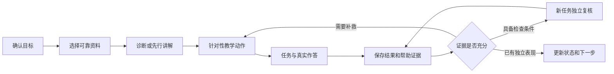
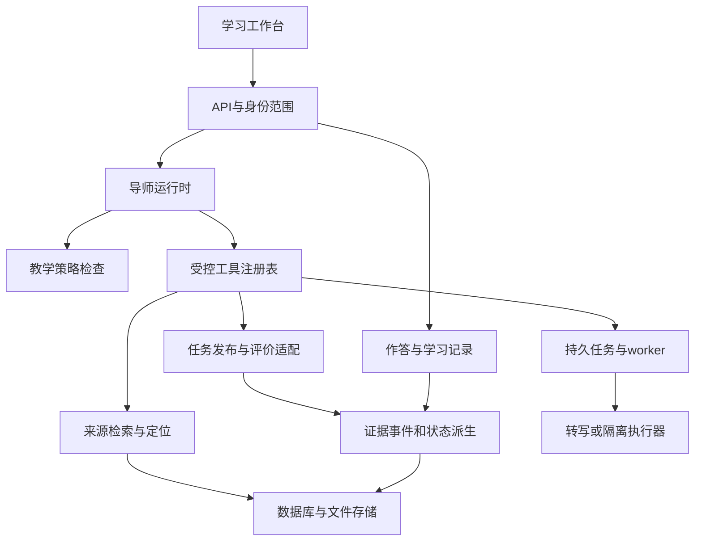
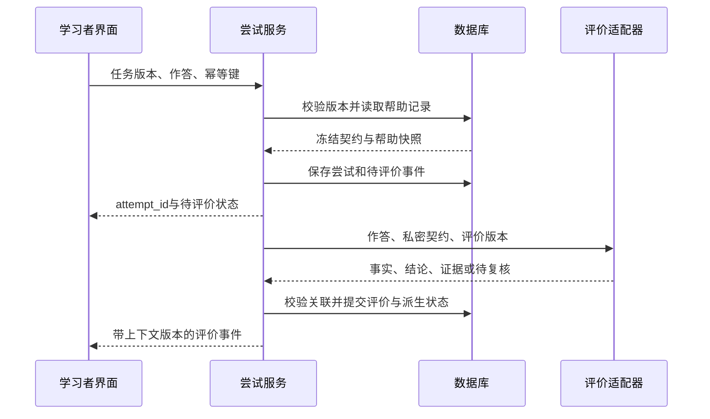

# 跨学科个性化学习 Agent 竞赛实施方案

编制日期：2026年11月2日。适用场景：全国人工智能应用创新大赛教育方向的非商业研究与演示原型。文档性质：可执行设计方案，尚未实施的软件能力、尚未下载的数据和尚未开展的实验均不作为完成事实。项目暂称“知行伴学”，名称可更换，功能和证据契约不依赖名称。

**执行摘要。**建设一个能够接入不同学科学习材料、形成可审核学习目标、依据实际作答调整教学动作、保存跨会话证据并安排独立复核的学习 Agent。产品不预先限定为编程或某一门课；开发收敛的是首版交互、工具数量、评价机制及已验证能力范围。以一个导师 Agent、一个持久状态服务和按任务类型选择的评价适配器构成最小主干，先完成真实工具闭环，再扩充视频、复杂知识追踪和多角色协作。首轮使用公开允许相应用途的资料、人工审核的任务和明确标注的合成案例推进工程验证；获得合适参与者和必要程序后再评价真实学习结果。

**阅读方式。**产品负责人先读第一、第二、第九、第十章；后端开发重点读第三至第六章；内容与教研人员重点读第四、第五、第七章；测试人员重点读第六、第八、第九章。所有章节属于同一方案，任务编号、状态名称和数据字段应在实现时统一，不能各自建立不同口径。文中工程阈值、数量和排期均标为设计目标或工作量假设，不是行业最低标准。

**内容导航。**第一章明确共识、证据与决策；第二章定义产品和交互；第三章处理参考项目；第四章准备数据和知识；第五章实现个性化教学；第六章说明架构、接口与执行；第七章给出跨学科演示案例；第八章建立评价；第九章拆解开发工作；第十章安排资源、交付、风险与扩展。文末附来源索引和启动清单。

## 一、项目共识、依据与需要停止重复争论的问题

### 1.1 已确认的产品边界

本方案吸收本次对话中的明确选择：参与的是比赛，当前不按商业产品融资、销售或采购交付规划；方向是跨学科个性化学习结合 Agent；已有四个固定版本参考项目和三份研究材料；目前没有能够反复接触并提供独立作答证据的真实试用人群。缺少试用人群影响效果结论和验证安排，不构成把产品强行改成单科的理由。项目可以先进行工程开发，同时诚实记录需求与效果尚待验证。

跨学科在此有两个层次。第一层是同一工作台支持不同学科，分别使用对应的内容、任务与评价器，这是首版目标。第二层是一个综合问题同时需要多个学科，例如从数据、数学和表达三个角度解释一个现实问题，这是可演示的扩展能力。不能把在三个标签下展示聊天界面称为已经解决跨学科迁移，也不能把同一模型能回答多个主题当成全部创新。需要证明通用流程在不同评价机制下仍然正确，跨领域证据也不会错误混用。

首版不设置“只能输入这三门课”的产品墙。用户可提出其他主题，系统根据资料和评价能力，显示“可据材料辅导”“可进行规则评价”“需人工复核”或“目前缺少依据”等实际状态。开放主题入口和对已验证能力诚实标注可以同时成立。没有足够资料时保留讨论能力，但不能生成虚假的来源、确定的掌握度或不存在的任务验收结果。

项目的首要业务命题是：面对相同学习目标，系统能否根据不同的真实学习证据，选择不同且合理的下一步，并通过后续独立任务检查这一选择。其可观察结果包括补救动作是否对应已确认困难、评价是否遵守帮助条件、重新进入能否恢复进度。长期成绩提升属于后续效果问题，不能在没有参与者时提前写进获奖材料。

### 1.2 问题定义与价值主张

用户触发点可以是上传讲义后想系统学习、做错练习后不知道缺什么、跨会话回来不知道从哪里继续，或在多个学科任务之间切换。现有常见做法是让模型解释、看完觉得懂了、继续追问，学习记录和任务结果分散。拟提供的改变是把目标、资料、作答、提示和评价连接起来，让用户知道“为什么推荐这一项”和“有什么证据支持当前状态”。这个描述是待验证的产品假设，并非已证明所有学习者都有相同痛点。

面向学习者，核心价值是减少无针对性的重复讲解、把困难拆成能行动的小步骤、区分受助完成与独立表现。面向教师或内容审核者，核心价值是能看到具体证据和可修改的课程材料，而非只有黑箱总分。面向比赛评审，核心价值是看到模型确实调用工具、读写持续状态、处理失败并依据结果改变动作，能够复现团队实现的增量。三者的价值应有共同证据，不能各用一套夸大故事。

首版成功不要求精确估计一个人的完整能力，也不要求重建整套教育学理论。对于一个知识目标，能够报告“已经讲解”“有过受助完成”“尚无独立证据”“已有独立表现”“延迟保持待验证”，通常比显示一个没有校准依据的百分数更有用。用户应能查看来源、纠正误解、撤销不实偏好、退出当前计划，并在不损失草稿的情况下继续其他学习。

本项目不能把“教育行业存在难题”直接用作需求已经成立的证明。开发中设置需求证据栏：研究文献说明问题可能存在，公开产品说明已有解决路径，真实观察说明本场景确有困难，小范围比较说明拟议机制是否有增量。没有真实观察时，需求状态为假设，仍可交付研究原型，但答辩必须说明证据所在层级。

### 1.3 研究材料的采用与修正

LearnLM 支持将教学要求写成可配置且可评价的行为规范，其主要结果是专家对教学表现的评价，不等于学生提分比例。EduClaw-Bench 提供长期模拟环境与多轴评测思路，论文中的数据量、人格日程配置和专家抽样是特定实验设计，不是本项目最低门槛。两者分别用于设计教学观察表和测试场景，不直接复制整套训练及评委成本。[LearnLM 原文](https://arxiv.org/html/2412.16429v3)、[EduClaw-Bench 原文](https://arxiv.org/html/2608.03206v1)。

Khanmigo 的学校实验应理解为包含练习平台与 AI 导师的整体方案证据，不能把整体成绩变化单独归因于聊天导师。此前材料把“至少使用过一次”误写为“只使用一次”，这项错误在本方案中不再使用。相关研究提示应关注实际参与，不能从一项场景推断所有学生的主要瓶颈相同。[学校实验](https://edworkingpapers.com/sites/default/files/ai26-1551.pdf)。

闭源与开源不是两条被永久锁死的教学路线。Khan Academy 官方已报告利用结构化学习历史、前置技能和相关对话改善产品的实验；它支持“历史信息可能有用”，同时提高“仅有长期记忆”的创新门槛。本方案只采用其方法启示：对不同信息增量做比较，保留未改善指标的结果，不把厂商报告等同独立长期验证。[官方产品实验](https://blog.khanacademy.org/how-khan-academy-is-building-a-better-ai-tutor-our-most-recent-learnings/)。

三家市场预测不再承担选题必要性的论证任务。口径、年份和市场边界不同的数据不能简单相加，也不能从预测收入推出本团队存在付费需求。比赛稿可以简述方向背景，核心篇幅应留给具体任务、真实工具、可解释决策和可复现结果。任何来自旧报告的金额、排名、最高最低或“首次”表述，在再次使用前均要单独核查。

### 1.4 技术决策与替代条件

默认技术方案是 FastAPI 后端、Vue 3 与 TypeScript 前端、关系数据存储、文件对象存储和一个模型适配层。选这组技术是为了与已阅读的参考和本地 Windows 环境衔接，并非比赛强制栈。后端先用明确的状态机和工具注册表实现主循环，避免同时引入多套编排框架。若团队已熟悉 LangGraph，可将同一契约映射为图节点；不得让业务状态与框架私有状态同时成为互相矛盾的真相源。

数据库首版采用 SQLite，事务处理尝试、评价和事件；多实例并发与协作需求明确后再迁移 PostgreSQL。资料检索先做带章节的分块、关键词和元数据过滤，有固定查询集后决定是否增加向量和重排。长任务通过任务表与独立 worker 管理，不把不可恢复的进程内后台函数当完整任务系统。具体依赖版本在首次实现时核查并锁定，本文不猜测未经安装验证的精确小版本。[FastAPI 后台任务说明](https://fastapi.tiangolo.com/tutorial/background-tasks/)、[Vue 官方入门](https://vuejs.org/guide/quick-start.html)、[SQLite 外键说明](https://www.sqlite.org/foreignkeys.html)。

默认不训练 KT，不是认为 KT 无价值，而是当前无目标用户序列，也尚未定义需要概率预测解决的决策问题。先保留兼容字段，使用证据和规则更新状态；当需要预测新题表现、安排复习且有足够可划分数据时，再比较简单基线与 KT。对模型预测必须校准，对跨学科共享必须按域验证，不能把不同学科的相同名称直接当同一知识组件。

### 1.5 三条验收线与项目停止条件

第一条是工程验收：身份和资源范围正确，工具有真实回执，错误不被包装成成功，重复请求不重复计分，中断能恢复。第二条是教学验收：有清楚目标、合法来源、经过审核的任务、对应的补救动作和可追溯评价。第三条是效果验证：获得适合的参与者与必要程序后，再比较独立作答和延迟表现。前两条完成不自动意味着第三条完成，三条都应在报告中分栏呈现。

停止增加功能的条件是出现核心记录不一致、评分依据不完整、帮助条件无法追踪、引用不能定位或队列失去任务。此时新增视频、动画和更多 Agent 不增加可信度，应回到数据与流程修复。停止某个实验的条件包括答案泄漏无法控制、分组严重不均、评价器与人类分歧未处理、成本超预算或样本不足以支持拟写结论。失败本身是可交付结果，隐藏失败才会使方案不可审查。

## 二、产品任务、界面与完整学习旅程

### 2.1 角色、入口与最小信息采集

角色分为学习者、内容维护者和演示观察者。首版本地部署可由一名参赛者兼任维护者，但接口权限仍要区分。学习者只能操作自己空间中的材料、作答和记录；维护者可以审核题目与课程包，但不能无痕覆盖历史评价；演示观察者读取去标识的案例与运行摘要。模型没有独立身份，所有调用继承经过服务端确认的用户与工作区范围。

进入系统先展示“继续学习”“围绕资料学习”“从目标开始”三个入口。已有会话优先恢复最近任务，不再次询问完整画像。新目标只采集确实影响下一步的内容：希望能完成什么、已有基础、可用时间、资料来源以及希望如何获得帮助。允许暂时跳过偏好，不把首次使用变成长问卷；对基础的自评记录为自述，后续通过任务核对，而不是直接给确定能力评分。

工作区属于一个学习项目，内部可以有多个学科和综合任务。一个学习者可以同时有“统计入门”和“阅读论证”两个工作区，偏好可在允许情况下共享，知识困难默认局部保存。比如“喜欢图示”可以是跨项目偏好，“不理解条件概率”必须绑定相应目标；不能因为某次数学受挫便把所有其他课程难度下降。

### 2.2 六个必要界面及其用户决策

首页展示当前目标、上次停留、待答任务和建议下一步。每条建议应说明来源于什么事实，例如“上次使用过提示，这次建议换题独立检查”，不能只有“AI 为你推荐”。资料页展示原始来源、解析状态、章节索引、可用范围与问题反馈。课程页展示目标及前置关系，状态用文字与图标共同表达，避免只用颜色区分。学习页保留原文、导师对话和任务区的关联；练习页区分提示与独立复核；记录页允许追查某次状态变化。

学习页采用可调三栏布局：左侧目标与资料导航，中间原文和任务，右侧导师。小屏幕时通过页签切换，而不是挤成三个不可读的窄栏。关闭导师侧栏不销毁作答草稿，切换资料也不自动切换当前考试上下文。生成内容逐步显示，但只有完成校验的引用和题目才变成交互对象；半截 JSON 不能直接被前端当最终题库渲染。

独立复核界面必须让用户理解当前条件：可阅读题面和允许的接口说明，是否可以回看讲义按任务契约显示。若用户请求直接帮助，应允许明确退出独立模式或将本次转为受助练习，保留原记录。不能为了守住一个“不提示”规则把用户困在无法退出的页面，也不能静默帮助后继续显示独立通过。

内容维护界面显示草稿、审核项、修改差异和发布版本。发布时检查来源、目标映射、答案契约、常见错误和复核用途。修改已发布题目建立新版本，历史尝试仍引用旧版本。演示页显示当前使用真实模型还是已保存回放，模型断网时切换回放也必须可见，避免把历史结果说成现场执行。

### 2.3 从资料到首次独立表现的主旅程

一次完整旅程从学生确认目标开始。系统解析资料并展示覆盖范围，再提出不超过必要数量的诊断任务。诊断不追求一次测完全部水平，而是确定当前目标需要哪些前置能力。学生可以选择先讲后测；顺序偏好不改变最后需要证据的原则。未作答只记录未观察，不能作为知识错误。

接下来导师读取当前目标、资料证据、最近尝试和帮助偏好，提出一个简短学习计划并执行当前步骤。先解释一段，再邀请预测、比较或动手；当学生卡住时，从局部证据选择补前置、换例子、分步提示或承认任务有问题。补救结束后换一个未暴露答案的任务，保存其与原题的关系。相同机制只改数字应标记为参数变式，不能直接当跨情境迁移。

系统根据复核结果更新局部状态。如果有独立表现，可建议下一目标；如果仍有困难，反馈缺口并提供选择；如果资料或判分依据不足，停在待复核状态。完成一次会话后生成可检查的学习摘要：做过哪些任务、哪次得到帮助、哪里已有证据、哪里仍未知、回来后做什么。摘要是导航，原始事件和作品才是依据，摘要出错可以重建。



### 2.4 功能优先级与明确后置内容

P0 包括资料定位、目标编辑、一个导师循环、任务作答、帮助记录、确定性评价或人工待复核、证据持久化、上下文恢复和基本来源说明。P1 包括课程草案、开放题评分辅助、复习提醒、跨学科综合任务、资源导出和可选视频转写。P2 包括训练 KT、多评委自动评分、多个持久伙伴、多模态生成和复杂推荐。优先级是开发依赖和验证成本排序，并不表示后置能力没有价值。

首版允许先使用经过审核的课程包，再逐步开放用户资料建课。开放建课不是把所有生成物直接发布：模型生成目标和题目先进入草稿，能够支撑来源与答案后才能用于自动计分；未审核内容仍可作为讨论材料，界面说明当前状态。这样保持跨学科入口，同时控制系统对评价结果作出的承诺。

验收时用结果而非页面数量判断进度。四个主要页面运行同一真实 API，优于十个页面各自展示假数据。视频和知识图谱必须服务已经存在的任务，不能为了视觉丰富先堆积素材。任何后置功能进入开发，都要写出它改变哪一个用户决策、需要新增哪份数据、如何证明收益以及失败时怎样回退。

### 2.5 用户故事与可检查的通过条件

用户故事 U01：学习者离开后回来，能够继续同一道未完成任务，草稿、帮助条件和资料位置保持一致。通过条件是服务重启后读取相同任务版本，历史请求迟到也不能覆盖新草稿。U02：学生看过提示后完成，记录页明确显示受助，不计入独立证据。通过条件是每次成功帮助交付都能定位到随后提交，未交付的内部检索不误计为帮助。

U03：学生质疑开放题评分，能够查看分项标准并申请复核，原评价保留且后续状态可以重算。U04：上传一个新学科章节后，系统不要求修改主程序才能创建目标草案；需要专门评价器时显示待支持，而不是返回假的自动通过。U05：相同学生在不同工作区学习，跨项目偏好按授权复用，局部误解不会被当作全局智力标签。每条故事在开发看板中绑定一个验收场景和所需证据文件，完成标记必须有对应运行记录。

## 三、四个参考项目的具体采用方案

### 3.1 固定版本、阅读顺序与复用原则

四个参考项目已经保存在本地，来源与完整性记录位于 [参考库清单](F:/实训伴学4/参考项目/_provenance/source-manifest.json)。本方案采用固定提交开展分析：personalized-learning-assistant 为 `6526c6f8f57a1eb3d5b0facc3f969abbe85fa86f`，DeepTutor 为 `f7aed0744c36c5afef16a4261c31ebee1208cac2`，Study-Mate 为 `d8114f38363272852b339d6788b2f8f007243b43`，bili-transcriber 为 `d4943ea96cf489cf9c2eedf7e6efbc17944ebbf5`。DeepTutor 是逐文件校验的完整源码快照，其余为浅克隆。下载完成并不等于项目已经在本机启动，本文没有把参考项目测试徽章转换成本团队实测成绩。

采用分四级：原则借鉴、独立重写接口、条件允许时复用代码、直接作为外部工具。优先读最小链条，不通读所有页面。每项采用建立记录，字段为来源文件、原解决问题、拟采用方式、适配风险、验收条件和当前状态。当前状态统一为“已核查设计，待实现”；只有进入新应用并跑过对应场景后，才改为“采用且已验收”。不能把一份调研报告写成已经完成技术融合。

不以拼接四套代码作为默认方案。它们的宿主、状态、依赖和产品目标不同，直接整合会产生多个用户体系、多个来源库和互相覆盖的进度。主应用必须只有一套学习证据契约，外部组件通过适配器接入。参考项目中的角色名称也不能直接变成团队的多 Agent 数量，只有存在独立任务、输入输出和可证明收益时才拆角色。

### 3.2 Study-Mate：采用课程与证据协议

重点阅读 [分层练习](F:/实训伴学4/参考项目/Study-Mate/preset/skills/layered-practice/SKILL.md)、[证据检查](F:/实训伴学4/参考项目/Study-Mate/preset/skills/evidence-check/SKILL.md)、[工具注册](F:/实训伴学4/参考项目/Study-Mate/lib/tools/index.ts)和 [运行事实](F:/实训伴学4/参考项目/Study-Mate/lib/lab/runner.ts)。采用的核心是目标驱动课程、讲解与任务分工、参考解与留白验证、结论必须指向证据，以及跨会话恢复摘要。独立重写课程包校验器，不让新系统依赖它当前的 DSH 专有宿主接口。

课程包发布前检查六件事：每个目标能观察、每个任务有题面、评价方式明确、答案或标准有依据、复核用途独立、来源可定位。对于可执行任务，初始留白不应通过，参考实现应通过，故意错误实现应被至少一个有效检查发现。对于解释任务，用合格、部分合格和概念错误示例检查评分标准能否区分。若这些示例本身无法区分，先修改任务，不把问题交给更强的模型掩盖。

不原样搬用其全部教学规则。例如“延迟重测才算独立证据”应拆成两个维度：是否在当前任务中获得帮助，以及是否隔开时间仍能保持。即时未受助的新任务可以证明当次独立表现，但不证明延迟保持；延迟也不能自动消除此前看过同一题答案的污染。这样既保留参考项目追求证据的优点，又避免把一个时间规则误当所有独立性的定义。

当前参考运行器使用子进程，路径和命令检查不等于操作系统级隔离。新产品若执行用户代码，必须另行接入有资源、网络和文件边界的执行环境，并验证实际约束；无可用环境时只报告静态检查或回放事实。它的代码可用于理解日志字段和任务流程，不能直接作为陌生用户代码已安全执行的证明。

### 3.3 DeepTutor：采用状态策略与统一循环

重点阅读 [Agent 循环](F:/实训伴学4/参考项目/DeepTutor/deeptutor/agents/loop/agent_loop.py)、[Chat 绑定](F:/实训伴学4/参考项目/DeepTutor/deeptutor/agents/chat/agentic_pipeline.py)、[学习策略](F:/实训伴学4/参考项目/DeepTutor/deeptutor/learning/policy.py)及记忆目录。采用统一工具循环、有限预算、分任务类型的评价入口、可追踪资料和区分受助表现的状态思路。新系统保持自己的数据对象，不复制大项目全部服务依赖。

导师每轮读取一个服务端状态快照，内容包括目标版本、当前任务、已有帮助、来源范围和仍未解决的问题。模型可以提出教学动作，状态服务验证条件后返回真实回执。回执不支持时不能在自然语言里宣布成功。循环终止于已回答、等待学生、工具失败、预算耗尽或用户取消，终止原因要持久保存。下一轮恢复时不重新执行已经成功的有副作用工具。

其记忆分层启发可简化为原始事件、可撤销事实和当前摘要。先实现正确的作用域与来源，再考虑复杂记忆图。比如用户说“这次赶时间”属于会话约束，不应永久写为“只喜欢简短解释”；某次错误属于目标局部证据，不直接变成全局能力。摘要仅用于读取效率，状态变化仍由原始记录重建。模型自述“记住了”不能替代写入回执。

不复制掌握度公式中的经验权重作为本项目标准，也不以字符串相似度概括所有开放题。首版将独立表现、帮助程度、目标覆盖和保持时间分别展示。如果后续引入概率模型，保留模型版本、训练范围、预测对象和校准结果，让概率与已观察事实保持可区分。迁移后的新策略必须通过本方案测试，参考项目原本能运行不能代替迁移验收。

### 3.4 personalized-learning-assistant：采用模块与草案流程

重点阅读 [编排](F:/实训伴学4/参考项目/personalized-learning-assistant/backend/core/graph.py)、交互式路径规划、练习搜索及练习总结路由。采用意图与能力分层、计划草稿和确认发布分离、真实资源候选，以及由程序计算客观统计再由模型解释的职责划分。参考其前后端模块组织，但不复刻所有画像雷达图和资源生成页面。

需要主动修正两个实现风险。第一，注册一个节点不意味着它已经进入运行路径，参考版本中的模式冲突节点没有连接进主图，因此新应用必须通过状态转换测试确认模式约束真实生效。第二，服务端重算分数仍需要服务端保存的答案契约；如果题面和答案键来自客户端请求，确定性重判也不构成可信考试。新应用只允许客户端传任务标识、版本和作答，答案依据从服务端冻结记录加载。

练习资源搜索采用“真实候选优先、缺失明确说明”的方式。格式匹配只能证明 URL 形状，不能证明题目可访问或适合目标。没有命中具体题目时可给官方检索入口，但展示为资源导航，不能生成一张仿佛已找到具体题目的卡。对于不能稳定获取的外部题，首轮不用于自动计分；导入并审核后才建立内部任务版本。

该仓库 README 未指定开源许可证并保留权利，本方案主要采用独立设计和阅读参考。非商业比赛也不自动授权复制无许可证代码。若后续确需复用其具体实现，应厘清授权；不需要因此停止独立实现相同的通用功能。许可证约束代码复制方式，不决定课程规划这一产品能力能否开发。

### 3.5 bili-transcriber：外部资料工具与任务机制

重点阅读 [MCP 契约](F:/实训伴学4/参考项目/bili-transcriber/app/mcp_server.py)、[任务管线](F:/实训伴学4/参考项目/bili-transcriber/app/pipeline.py)和结果写入器。若首轮确有视频课程材料，可作为独立本地服务接入，不把识别模型和 GPU 依赖嵌进主应用环境。主应用只持有工具任务 ID、来源、状态和产物引用，转写失败不影响其他文字课程。

即使暂不接视频，其提交、去重、查询和产物读取机制仍适用于课程生成、导入与评测。长任务提交立即返回 ID，状态写入任务表，完成后检查产物内容和版本；不能仅凭文件存在就算成功。取消要有明确结果，恢复不能擅自启动用户已经暂停的任务。重复提交按相同来源与参数去重，改变参数后才创建新的任务版本。

转写材料进入知识库前，抽查术语、时间对齐、公式和关键结论；视频中只有图表的信息不能假定已由语音覆盖。索引同时保存原视频时间与文字片段，回答可回到具体位置。模型生成的摘要与原始转写分开标记，不能将概括反过来充当原视频的逐字证据。视频获取和展示条件按源检查，不因为本地转写就默认拥有视频再分发权。

## 四、跨学科内容、任务与学习数据的建设

### 4.1 数据分层、命名与最小数据字典

数据分七类：原始来源、可引用片段、目标与关系、任务与评价契约、学习尝试、帮助与执行事件、实验记录。来源解决“依据是什么”，目标解决“学到哪里”，任务解决“如何观察”，尝试解决“发生什么”，策略解决“下一步为何如此”。这些类别不应塞进一张由模型自由改写的画像 JSON。允许用 JSON 交换，但持久化对象及其版本需要明确约束。

统一标识采用不可猜测的稳定 ID，所有业务对象绑定工作区、版本和创建者。显示名称可修改，ID 不随名称变化。时间保存带时区的标准值，界面按 Asia/Shanghai 展示；延迟复核按真实时间差计算，不以日期字符串不同代替间隔。材料更新后形成新版本和哈希，旧引用继续可追踪；如果无法保留原文副本，至少保存定位、指纹和失效状态，不能悄悄把新内容套到旧成绩上。

| 对象 | 核心字段 | 谁可以创建或更新 |
|---|---|---|
| Source | id、version、title、uri、license、scope、hash、status | 导入服务与维护者 |
| Chunk | id、source_version、locator、text、tags | 解析与索引服务 |
| Objective | id、domain、observable_goal、prerequisites、review_status | 内容草案服务与审核者 |
| TaskVersion | id、version、objectives、kind、public_prompt、private_contract | 任务发布服务 |
| Attempt | id、task_version、learner、response、submitted_at、context_revision | 学习者提交，内容不覆写 |
| Assistance | id、attempt_context、type、delivered_at、receipt | 应用交付服务 |
| Assessment | id、attempt、rubric_version、verdict、evidence、status | 评价器与复核流程 |
| LearningEvent | id、scope、event_type、payload、parent_id | 服务端业务事务 |

字段只允许表达能够支持的事实。未审核目标标为候选，未采集帮助条件标为未知，无法自动判定的任务进入待复核。需要个人偏好的字段保持可撤销，并记录来自学生明确表达还是模型推断。删除个人记录时按实际数据策略处理相关缓存与导出副本，不能只删前端列表而继续在摘要中使用。

### 4.2 内容来源池与比赛使用记录

现有授权来源清单是检索起点，不是全部授权已完成的证明。首轮优先选择能够明确下载、定位与注明出处的材料。PY4E、OpenStax、Think Python 等提供可选择教材，具体许可与版本分别核对；GSM8K 与 HumanEval 可用于理解任务和评价格式，不意味着它们天然覆盖全部课程目标。XES3G5M、EdNet、Junyi、ASSISTments、DataShop 和语言日志属于行为研究候选，按具体用途和条款进入独立数据区。[PY4E](https://www.py4e.com/book)、[OpenStax 许可说明](https://openstax.org/faq)、[Think Python 第三版](https://greenteapress.com/wp/think-python-3rd-edition/)、[GSM8K](https://github.com/openai/grade-school-math)、[HumanEval](https://github.com/openai/human-eval)。

每个来源建立使用记录：实际下载地址、日期、发布者、版本、许可证原文位置、允许用途、是否可改编、是否可分发、是否需个人账号及此次拟用环节。非商业比赛不需要预先完成商业授权谈判；但将数据用于本地研究、放进公开仓库、上传模型服务、交给评委下载和截取案例展示，是不同操作，应记录实际用途。不能用统一的“研究使用”标签覆盖额外条款。

CC BY、NC、SA、ND 与平台研究协议分别解释。NC 不等于只允许学术论文，SA 也不意味着所有关联软件自动采用同一许可。CC BY-NC-ND 4.0 对制作和分享改编材料有区别，论文许可不能未经核查扩展为代码许可。XES 仓库代码与数据文件、题目图片的授权范围分别核查。Think Python 不能跨版本统一写 CC BY 4.0。涉及不确定范围时先采用独立原创样例或可引用的短片段，保留候选来源而不假定全量分发权。[CC 官方 FAQ](https://creativecommons.org/faq/)、[CC BY-NC-ND 原文](https://creativecommons.org/licenses/by-nc-nd/4.0/legalcode.en)。

内容池至少覆盖不同的知识表达和评价方式，而非机械追求学科数量。可以准备一个定量推理单元、一个程序或操作单元、一个证据论证单元作为首轮验证。它们是检验同一核心是否适应不同任务的样例，不是产品学科上限。若用户上传新主题，依然走相同导入和草案路径，只是已审核内容和评价器覆盖程度不同。

### 4.3 知识组件与跨学科关系的建设程序

知识组件采用“可观察能力单元”而非无限拆分的术语清单。每个单元要有简明定义、适用上下文、前置能力、至少一种观察任务以及至少一份支撑材料。比如“百分比变化”不能只给名称，应写清学生能否区分原值、增量和分母。组件粒度以能支持教学决策为准：太粗无法定位，太细会增加内容与数据维护，不能用节点数量本身作为先进性的展示。

构建分五步：从资料和目标抽取候选；合并同义名称并保留来源术语；补齐可观察行为；提出前置或关联关系；由内容审核者检查关键边并发布版本。前置关系不一定是单树，可以是有向依赖；案例、例证和对比关系另设边类型，不混在前置里。涉及循环依赖时先检查是否拆分粒度或边含义错误，不在无法排序的结构上强行生成课程。

跨学科关系要说明迁移机制。数学中的条件判断与编程条件分支可以形成概念对应候选，但不能因名称相似就共享掌握度。更稳妥的方式是设置桥接任务，观察学习者能否解释同一逻辑在不同表示中的适用条件。桥接任务通过仅支持明确的关系，不能给“逻辑思维”这类过大的全局标签授予掌握。没有足够证据时关系标为启发参考，不进入自动跳课规则。

审核重点放在会改变路线的关系、容易混淆的边界和评价映射，而不是让专家逐字重写所有模型候选。审核界面显示原文定位、候选解释与影响范围。每次发布记录审核者与时间；变更前置关系时列出受影响课程和待答任务，保留已发生尝试。用户可以选择继续旧计划或接受新草案，系统不能在学习过程中无提示重排全部目标。

### 4.4 题目、作品与错误案例的建设程序

每项任务至少明确能力目标、材料范围、题面、提交形式、允许帮助、评价方式和结束条件。一个任务可以对应多个目标，但应区分主要目标与辅助要求；题目本身要求学生从未学过的表述能力时，不应把语言困难全算成目标知识错误。难度先以专家预估标签保存，不伪装成有大样本支持的统计难度，后续根据真实数据校准。

任务分为选择判断、数值短答、过程解释、代码操作、作品交付和综合论证。选择题需要排查长度或格式泄露答案，数值题需要单位、精度和容差，解释题需要因果与条件标准，代码题需要输入输出和资源条件，作品题需要分项要求与可接受替代方案。每类准备合格、部分合格和不合格样例，用于检查评价标准是否可执行。模型生成样例经人工审核后才可当标准，不让自我一致性替代正确性。

题面与私密契约分开存储。学习阶段可以在学生明确请求后查看参考解，但查看事件要记录；独立复核阶段的参考答案和隐藏测试不进入检索索引。训练、调试、演示和评测用途分别标记，高度相似的任务按同一题族分组，防止把改数字的变体分到不同集合。每次生成新题先标候选，检查来源与可解性后发布，不将流式半成品直接作为正式题目。

错误案例库记录“观察到的回答”“可能原因”“确认需要的追问”“适合补救”“不应采取的动作”。例如结果错误可能是概念、运算、读题或环境问题，只有确切证据才能确认。即使存在预设错误模式，也要允许多原因和未知，不能为了给每个学生归类而强行匹配。每次新增错误模式说明来自合成构造、公开案例还是实际试用，三者在分析时分别统计。

### 4.5 行为数据、采集顺序与数据质量验收

公开行为日志用于研究数据结构、回放策略和可选 KT 实验，不直接替代目标用户。数学平台序列能支持相应数学任务建模，不能单独证明开放论证或外语表达的个性化效果。研究中需要保留学生、题目、时间与知识标签映射，并检查缺失、重复、时间异常和多版本标签。相同学生的相近序列不得穿越训练与测试边界，时间预测也不能使用未来统计特征。

当前从三层数据开始：原创合成案例验证工程规则，公开数据子集研究状态更新，真实试用后采集实际记录。合成案例明确写入 `synthetic=true`，回放明确写入原来源和时间，不进入真实参与者人数。实际采集先确定最小需要的信息，不为了未来可能训练模型而收集与当前任务无关的身份、健康或家庭信息。数据处理依据和研究程序在开展相应活动前确认。

质量验收按用途而非体量进行。资料集验收定位完整率与解析抽查，课程集验收目标与来源覆盖，题库验收答案正确性与题族隔离，事件集验收幂等和因果顺序，实验集验收分组与版本冻结。7,652 道题、5,027 条序列等论文规模不作为项目门槛；如果以后训练模型，通过学习曲线、分域测试和校准判断是否有足够证据支持采用，而非追平一个表格数字。

## 五、个性化机制、教学动作与跨会话记忆

### 5.1 学习状态的表达与更新规则

状态不采用一个总分解释所有能力。每个目标保存四条相互独立的维度：覆盖程度、任务表现、帮助条件和保持证据。覆盖程度为未涉及、部分讲解、已覆盖；任务表现为未观察、存在困难、部分符合、符合标准；帮助条件为未知、受助、当次未受助；保持证据为未检查、已安排、延迟任务有证据。前端可合成为简洁标签，但详情能够恢复原四维，不能把未知静默显示为零分。

一次作答评价完成后，服务端从对应题目版本和帮助事件计算哪些证据可以进入状态。答对且使用了关键提示，只增加受助练习证据；题目无效、答案键存疑或执行环境不支持，记录为任务或环境问题，不扣学习能力。评价被复核撤销时，不直接修改汇总分，而是作废相应证据并重建派生状态。这样可解释历史变化，也避免画像因为一次错误评价长期污染。

推荐下一步时先确定用户当前明确请求，再检查待答任务、先修缺口、最近证据和复习到期。用户要求简单核对，系统不擅自生成完整课程；用户选择先讲后测，系统按该偏好安排，但仍如实记录尚无独立表现。多次连续困难需要缩小任务或检查题目，不触发无限补题。补题有进行中任务保护和冷却，学生可以跳过、暂缓或换目标，跳过不等于掌握。

正式状态修改只通过服务工具，模型不能直接写 `mastered=true`。工具返回修改前后版本、使用的证据 ID、规则版本和结果。模型可解释“这次独立任务符合哪些标准”，不能把自己的鼓励语作为状态依据。没有足够证据时显示“目前只能确认这一项表现”，这是信息精确性，不是劝退学习者的负面标签。

### 5.2 教学策略库与动作选择

策略库由有限动作构成：确认目标、读取材料、提出诊断、简洁讲解、使用类比、给出反例、分步提示、请求预测、安排练习、反馈错因、安排独立复核、标记待复核、调整后续计划和结束会话。每个动作有触发条件、允许材料、产生的事件和停止条件。模型负责在允许集合中提出合适动作，应用检查当前模式和上下文是否允许执行。角色名称不代替动作契约。

例如策略 P01 在目标依据不足时读取指定资料，不先编造结论；P02 在学生能复述定义但应用错误时安排对比例子，而非重复同样定义；P03 在连续两次同类失败时检查前置能力或任务歧义；P04 在用户明确请求答案时，根据练习模式决定展示参考解并记账或退出独立模式；P05 在任务执行失败时先区分用户代码错误与运行器故障；P06 在证据充分且学生同意时推进下一目标。所有策略应有正例、反例和禁用上下文。

动作选择不是追求“问得越多越像教师”。学生确实缺少一个知识前提时，需要直接说明；已经能独立完成时，不应继续机械追问阻止前进。提示按从少到多组织：指出观察方向、指出相关概念、提供局部线索、展示部分步骤、展示完整参考。每次帮助只记录真实交付的级别，不能把模型内部检索或草稿当成学习者已经看到的提示。

策略解释采用简短可检查的理由，比如“你在两次任务里都把变化量除以新值，先做一个分母对比”。它引用观察事实，不展示模型内部思维链，也不对人格作推测。若原因只是候选，应说“可能是这个环节，先用一小题核对”。跨学科动作共享形式，但内容标准和可接受答案由对应课程包提供。

### 5.3 独立性、迁移与保持的证据边界

当次未受助不等于从未接触过同题。独立证据计算需查看题族、答案暴露、最近讲评和任务条件，而不是只检查本次是否点提示。系统默认把相同题目答案暴露后的重做当练习，把参数变式作为近迁移候选，只有情境、表示或约束发生实质变化并经审核，才允许标为相应的迁移任务。不能用随机数变化制造“全新考试”的假象。

延迟复核的时间间隔由学习目标和实际安排决定，首版可以采用明确的工程设置，但需显示为计划规则而非科学定律。用单独的新任务检查保持，记录期间是否有其他学习或帮助；没有观察这段过程时不虚构“完全未复习”。如果比赛当天无法等待真实间隔，演示可以展示已保存的合成时间案例验证调度，但不能把修改系统时间当真实保持结果。

开放任务的独立性还要看资料使用条件。允许开卷的史料论证可以引用原文，其独立性体现在是否自主组织论据，不等于禁止阅读；程序任务允许查接口文档，也不等于获取完整解法。每个任务明确允许资源和禁止的答案暴露，避免把所有学科统一成闭卷测验。对外展示时说明证据成立的条件，而非只给一个脱离上下文的通过勾。

受助成功本身有价值，它说明当前支持使任务完成，是教学过程的一部分。记录受助并非惩罚使用帮助，而是避免夸大结论。产品可表述“这一步在提示下完成，接下来换题检查”，同时允许用户继续学习，不能为了数据纯净而牺牲正常求助体验。状态模型的作用是清楚表达证据，而不是形成新的考试压力。

### 5.4 记忆治理与学习者控制

记忆分为稳定偏好、目标局部观察、会话约束和原始事件。稳定偏好必须可查看和修改，例如语言、阅读形式、是否喜欢先看例子；局部观察绑定目标和证据；会话约束包括本次时间预算、当前情绪表达和临时模式。未经明确支持，不把“这题好难”写成长期焦虑标签，也不从沉默推断智力、动机或健康状况。

写记忆的入口要求来源、范围、有效期和置信状态。明确表达可以记录为用户确认，模型总结记录为候选并限制使用。跨会话恢复优先读取正在进行的目标与任务，再加载相关偏好和少量必要历史。摘要有长度上限，全文日志在需要申诉、定位或重建时按范围读取，不能每轮把所有学科材料拼进上下文造成成本和错配。

撤回一条记忆时要处理派生摘要，系统可以重建而不是依赖模型承诺“忘记”。学习者可以选择删除工作区或导出个人记录，导出只包含有权提供的材料和记录；来源受限时导出引用与定位，不整包带出原数据。真实身份与学习事件标识分离，演示数据不出现真实参与者可识别信息。学生模型是服务当前学习的工具，不用于排名或做没有授权的重大判断。

### 5.5 可选 KT 路线与采用门槛

只有当决策需要可校准的预测时才启动 KT 子项目，例如在多个候选任务中选择适度挑战的下一题、估计某知识组件近期表现趋势或研究复习安排。先写预测对象，是下一题正确概率、步骤错误还是长期保持；不同对象的数据和评价不能混用。先用简单频率、逻辑回归或基础知识追踪方法作为基线，复杂模型必须以独立划分和对应指标证明收益。

数据量由模型学习曲线和覆盖决定，不预设几千条以下无效。分别观察题目稀疏、学习者冷启动、目标覆盖和时间变化。模型在旧题旧学生上表现好，不代表能处理新题新学生，因此测试集至少区分相应场景。AUC 只描述区分能力的一部分，仍需概率校准、Brier 或相关误差分析，并检查关键决策是否改善。没有这些证据时，概率只作研究输出，不直接控制跳课。

跨学科可比较独立模型、共享编码加领域头、内容特征迁移等方案，但每个领域独立报告，不用总体平均掩盖某科退化。知识关系候选与真正可共享的能力保持区分。多领域建模已经是研究路线，但不能把存在论文理解为本产品已经具备迁移效果。[多领域知识追踪研究](https://arxiv.org/abs/2608.24005)。若 KT 没超过简单规则，保留结果并使用更易解释的方案，比赛价值仍可来自可靠教学闭环。

## 六、工程架构、接口、任务和运行机制

### 6.1 模块、部署单元与代码组织

主应用分前端、API、导师运行时、教学策略、来源服务、任务与评价、学习事件、后台 worker 和外部工具适配器。逻辑模块独立，不意味着每个都立即拆成微服务。首版一个后端进程处理普通 API，一个独立 worker 处理长任务，数据库与文件目录持久化即可。图检索、缓存、消息队列和多实例在确有性能或部署需求后增加，避免接口尚未稳定便引入大量基础设施。

建议新应用目录为 `app/backend`、`app/frontend`、`content_packs`、`evals`、`docs`、`scripts` 和 `data`。参考仓库保持在原目录只读研究，不修改成业务代码目录。后端再分 `api`、`domain`、`services`、`agents`、`tools`、`workers` 和 `storage`。领域对象不依赖具体模型 SDK，模型提供商、转写器和执行器通过接口替换。测试数据放在专用目录，不把真实个人日志提交到代码仓库。

前端状态分页面草稿、服务端快照和流式事件。草稿按工作区与任务版本保存，服务端状态包含 revision，流式事件包含 turn 与 sequence。切换目标、取消生成或开始新尝试后，前端只接受匹配当前上下文的结果，旧请求可进入历史但不能覆盖当前任务。恢复时先读取服务端快照，再从最后事件序号补齐，避免同时恢复旧缓存和新状态造成闪回。



### 6.2 Agent 输入、工具契约与预算

每个导师回合输入包含经过身份绑定的工作区、用户消息、模式、当前目标、目标版本、任务上下文、允许来源、预算和状态摘要。检索文档、网页和学生作答属于资料，不具有系统指令权限。主提示词只定义角色、边界、模式规则和回应结构，具体事实通过工具取得；不把所有参考答案放入通用提示。模型输出调用后，应用进行参数、权限和版本检查，再运行工具。

首版工具建议如下。`get_learning_context` 返回当前状态；`search_sources` 按工作区检索公开学习片段；`read_source` 读取具体定位；`propose_plan` 建立草案；`publish_task` 仅发布经过检查的版本；`request_hint` 生成可交付帮助；`evaluate_attempt` 调用评价器；`get_feedback` 读取已保存评价；`propose_next_step` 提出下一动作；`get_job_status` 查询长任务。提交作答和帮助记账优先由应用界面调用，模型不能凭自己描述制造学习者提交。

所有工具统一返回以下形状。`ok` 表示本次工具请求是否按契约完成，`status` 表示业务状态；两者不能混为“学生通过”。`error` 含可恢复类型与建议，`evidence_refs` 仅引用真实存在的对象。HTTP 成功不等于业务成功，模型自然语言也不等于写入完成。

```json
{
  "execution_id": "tool_opaque_id",
  "ok": true,
  "status": "completed",
  "data": {},
  "evidence_refs": [],
  "error": null,
  "duration_ms": 0,
  "context_revision": 12
}
```

预算按回合调用数、总耗时、模型输入输出和费用上限共同控制。首轮可将最大工具轮数设为六轮、只读失败最多重试一次作为工程默认，实际根据运行记录调节；不是教学标准。等待学生输入时立即保存并结束活动调用，不持续轮询模型。预算耗尽返回已有可靠结果、未完成项和恢复入口，不通过提高隐藏重试次数伪装成功率。

### 6.3 API、事件与幂等事务

API 以工作区为主要资源范围。建议提供创建工作区、导入来源、查询导入任务、读取目标、保存计划草案、发布课程、打开任务、提交尝试、读取评价、交付帮助、申诉和获取事件流等端点。以下为拟定契约，不是已经存在的服务；实现时需要生成 API 文档和相同的客户端类型，不能靠手写两份相似结构保持一致。

| 方法与路径 | 请求要点 | 返回或副作用 |
|---|---|---|
| POST `/api/workspaces` | 目标、名称、可选资料 | 工作区与初始revision |
| POST `/api/workspaces/{id}/sources` | 上传或允许的来源引用 | 导入job_id |
| GET `/api/jobs/{id}` | 服务端绑定身份 | 阶段、错误、产物引用 |
| POST `/api/workspaces/{id}/turns` | 消息、模式、revision | turn_id与事件入口 |
| POST `/api/tasks/{id}/attempts` | task_version、作答、幂等键 | attempt_id与评价状态 |
| POST `/api/tasks/{id}/assistance` | 帮助类型、上下文版本 | 帮助内容与交付receipt |
| POST `/api/assessments/{id}/appeals` | 异议、证据引用 | 复核状态 |
| GET `/api/workspaces/{id}/events` | 最后sequence | 顺序事件与当前版本 |

提交尝试的事务顺序为验证身份、加载服务端任务版本、校验上下文、按幂等键查重、冻结帮助条件、保存作答、创建评价任务和提交事件。慢模型评价在事务外执行，结果回来后再次检查任务和尝试关联，随后写入评价及派生事件。不能在长时间模型调用期间持有数据库写锁，也不能让模型结果直接修改另一个已经切换的目标。

幂等键由稳定用户意图生成，同一次提交网络重试使用同键。键相同但内容哈希不同返回冲突，不随意覆盖旧记录；确实修改答案形成新尝试。帮助交付同理，模型生成但未交付不计账，成功返回并由界面确认展示后产生可追溯事件。对无法确认是否展示的网络边界，记录交付状态未知，独立性评价保持保守，而不是假定用户没看到。

事件包括 source_ready、plan_proposed、task_opened、attempt_submitted、assistance_delivered、assessment_completed、assessment_voided、state_updated、turn_paused 和 turn_finished。事件 payload 只保留需要的业务信息和引用，不公开内部推理。每条有唯一 ID、工作区、序号、时间和因果父项。回放消费已发生事件，不重新执行工具；重新执行必须建立新 run 并明确区分。

### 6.4 评价器、权限与执行环境

评价适配器输入是冻结的任务私密契约、学习者作答、允许资源和帮助快照，输出是分项事实、候选结论、引用与置信状态。确定性评价包括选择比较、带单位的数值规则和经过验证的测试；开放评价采用明确 rubric、证据摘录和人工待复核入口。不能用关键词命中代替因果理解，也不能用模糊字符串相似度统一判断数学等价与文本正确。

模型辅助评分要验证输出结构、评分范围和证据摘录确实存在于作答中。缺证据、来源不支持、标准含糊或评委明显分歧时进入待复核，不给默认合格分。学习策略可以利用部分已确认事实继续教学，但汇总页面必须显示未确认项。修改 rubric 建立新版本；是否对旧记录重新评分由显式任务处理，保留新旧差异和理由。

执行学生代码是独立服务能力。普通子进程、AST 检查或命令白名单不构成充分隔离，执行器必须具备可验证的资源、文件和网络边界，并处理超时、取消、输出上限及子进程清理。任务采用受审查镜像和固定依赖，不把宿主密钥、个人目录和任意文件挂载进去。验收应包含越界访问、无限输出、超时与取消等实际场景；约束未通过前不开放任意代码运行。缺少环境时展示静态反馈或事先记录的回放，不能显示“真实测试通过”。

来源访问以资源范围过滤，用户上传的文档不能改变工具权限。私密答案和隐藏测试使用独立存储入口，不进入搜索工具结果。教师审核接口与学生接口分别鉴权，本地演示也不靠模型口头承诺区分身份。对新学科的评价器配置，先用审核样例检查，再允许影响正式记录；未支持的任务形态返回明确状态而不是让模型自由创造评分规则。

### 6.5 任务恢复、可观测性与Windows开发

长任务状态为 queued、running、waiting、completed、failed、cancelled，保存参数哈希、当前阶段、产物引用、错误和更新时间。worker 获取任务时使用租约或明确认领机制，进程崩溃后只有过期且可恢复的任务进入重试。保存产物先写临时文件，再原子替换，随后在同一业务提交中标记完成。部分成功时保留已产物和恢复点，不能把未完成的索引标成可检索。

每次运行记录 run_id、模型配置、工具调用、版本、时间、tokens、费用和结束原因。成本按实际回执汇总，模型未返回用量时标为估算，不把估计写成账单。日志中的用户内容按需要最小化，研究导出与产品日志分离。可观测页面关注用户任务是否完成、资料为何没命中、哪个工具失败，不把内部实现术语堆给学习者。

Windows 环境按一个项目一个虚拟环境、一个前端依赖锁文件组织，路径使用明确根目录与规范化解析。文档中的启动命令在项目创建后再验证，不能把计划目录写成现有程序。第一天记录 Python、Node、包管理器、模型服务和可选执行器实际版本；安装依赖与下载大模型是后续开发活动，当前方案不代替执行。运行环境无法满足时优先保留文字与规则评价闭环，而不是为了演示 GPU 能力牺牲主流程。

数据库启用并测试外键，迁移脚本可重复判断当前版本；备份恢复要在复制数据库上验证，不能在用户学习记录上试删。前端构建与后端导入检查属于发布前必要步骤，端到端流程只在新的变化或未解决风险时扩展复测。演示结束后保留用户需要继续使用的服务，不随意清理活动环境；临时验收服务器和正式演示服务分别管理端口与数据目录。

## 七、跨学科验证包与端到端演示案例

### 7.1 三种任务机制共用一条主流程

首轮验证包覆盖定量推理、程序任务和证据论证三种评价机制。选择它们是为了检验接口和状态的通用性，不是宣称这三类涵盖全部教育，也不是要求最终产品只支持数学、编程和写作。每包使用相同的目标对象、作答入口、帮助事件和评价结构，评价适配器则不同。新单元接入时主要增加资料、目标、任务和评价配置；需要修改通用代码的地方记录原因，作为架构是否真正通用的观察项。

每包先编写一份可审核的简短材料和目标表，再准备诊断、学习与复核任务。原型工作量可以从每包五个目标、每目标四项任务估算，但实际以覆盖需要为准。下面的数值、回答和情节都是方案中的原创合成案例，不是已采集学生数据，也不是已运行实验结果。演示时保留“合成案例”标识，产品验证和需求访谈仍需后续真实活动。

### 7.2 定量推理：百分比的基准量

目标为区分变化量、基准量和百分比，能够解释连续变化为什么不能总是直接相加。材料先说明百分比必须相对于某个基准，给出一个清楚例子与反例。诊断题可以问“原价一百元上涨百分之二十，再按新价下调百分之二十，最终价格是多少，并说明两次计算的基准”。这一题的私密契约保存数值、单位与关键解释，学生界面只看题面。

合成作答 A 回答“一百元，因为加减抵消”；作答 B 回答“九十六元”，但解释不清；作答 C 正确列出两步和基准。A 触发基准对比补救，B 可以先用追问区分计算碰巧正确和理解，C 进入不同表示的任务。不能因为 A 错就推断所有算术薄弱，也不能因为 B 数值正确就宣称目标全覆盖。数值维度和解释维度分别记录。

补救采用两栏表示：第一次相对于一百，第二次相对于一百二十。若学生请求完整答案，可以给出并记录答案暴露；下一步使用未泄漏的新任务检查。近变式可改变价格与比例，但其题族保持关联；更远的复核可以换成增长率报道，要求判断“先增后减”表述的适用条件。只有实际改变表示和推理要求且经过审核，才标为相应迁移，不把换数字直接称跨情境。

评价器先检查可解析数值与单位，再按解释标准判断两个基准是否识别。无法解析文字时询问澄清，不默认判错。最终记录可以是“数值符合、解释部分符合、已使用步骤提示、独立复核待完成”。这个结构比单一百分制更适合作为导师下一步的输入。演示中切换另一合成学生，相同题目可以触发不同动作，从而展示个性化发生在决策而非称呼。

### 7.3 程序任务：筛选与累加

目标为在一组记录中选择符合条件的项并正确累加，能够区分赋值、累计、计数和条件方向。材料给出变量变化表和一个不暴露正式任务答案的短例。任务使用经过审核的函数接口与输入输出约定，学生填写部分逻辑。参考实现和检查程序独立存储，前端不从接口收到隐藏答案。运行器不可用时可以先用结果预测任务验证教学链，不能把静态推断显示为实际执行。

合成作答 A 每轮覆盖总和，B 筛选条件写反，C 正确但调用环境缺包。系统读取真实执行事实或明确的静态证据后，将 A 与 B 区分为不同候选错误，C 标记环境问题。A 的补救要求追踪变量，B 的补救要求列出边界输入，C 的支持是恢复环境或切换可用任务。三者都得到同一套“你基础不足”的反馈就说明诊断没有实现。

参考检查至少覆盖空输入、全部不符合、恰好位于边界和多个符合项，避免仅用一个正常样例。初始留白必须被检查发现，错误实现也要能被相应反例发现。学生自己写的测试可作为解释与验证能力的证据，但不能替代隐藏覆盖全部条件。若学生修改了检查脚本，记录作品变动并使用服务端冻结版本判定，防止通过删断言产生成功。

独立复核换成另一种记录结构或要求学生先说明判定逻辑，但仍允许读取接口说明。提示与答案暴露按任务版本绑定，立即重做原题保留为练习。任务完成不自动授予所有编程能力，只更新明确覆盖的目标。结果页显示实际命令、运行器、关键输出、是否截断和任务版本，学习者看到友好的说明，评审能够展开核查事实。

### 7.4 证据论证：相关关系与因果推断

目标为从给定材料提取事实、区分推测和结论，并说明替代解释。准备一段团队原创的合成观察记录：某班调整学习安排后作业完成率上升，但同期还更换了作业内容。它不是现实学校数据。任务要求用有限文字判断“安排调整导致完成率上升”是否得到充分支持，并列出还需要的信息。这检验开放论证评价，不要求系统擅自搜集学生真实数据。

rubric 分为事实引用、论证范围、替代解释和进一步证据四项，每项有可接受表达与常见误判。回答可以采用不同立场，只要证据与结论匹配。不能把“出现相关性不等于因果”这句话当自动通过关键词，也不能因为学生文字不符合参考答案句式就判错。评价输出引用学生实际句子，指出已经做到和仍缺少的部分。

合成作答 A 直接肯定因果，补救围绕共同变化；B 只背诵口号却没有使用材料，补救要求绑定证据；C 提出替代解释并说明局限，可以进入另一短材料复核。若模型评委与人工标准存在实质分歧，显示待复核，仍可就已确认的事实引用继续辅导。开放任务中合理不同答案的处理，是跨学科原型必须展示的能力之一。

独立复核可以使用另一段同样为原创的材料，改变干预、结果和潜在混杂因素，要求学生指出推断条件。不能将原题详细讲评保留在复核输入里，同时声称无帮助。评分标准可向学生公开，参考答案与评测保留项仍按契约隔离。结果按分项表现表达，避免用一个没有校准的精确百分数排名。

### 7.5 综合案例与演示脚本

综合案例可以是“解释一份校园用电方案”：提供明确标注为合成的用电表、设备额定功率和不同方案的约束；学生需要计算、可选写程序，并撰写证据支持的建议。各子目标分别绑定定量、程序和论证评价，不用一段流畅的文字掩盖计算错误。跨学科连接通过一个共同问题表达，证据仍分项保存，不把某科成功自动传播到其他科。

现场演示建议用一名操作者与两个可切换的合成学习记录。先展示同一目标下两种不同下一步，再展示帮助记账与新题复核；随后切换任务类型，证明不用换一套程序；最后模拟任务失败与恢复，展开真实事件和版本。演示控制在能解释清楚的时长，视频、动画和复杂图谱只在不挤占关键证据时加入。现场使用回放要明确标识，现场模型调用失败也保留可解释结果。

## 八、工程测试、教学审核与效果评价

### 8.1 测试层次与评价对象

测试分契约、规则、服务集成、界面流程、教学审核和效果研究六层。契约检查字段、权限和版本，规则检查状态派生与独立性，集成检查工具真实执行与持久化，界面检查草稿与迟到响应，教学审核检查资料和任务是否成立，效果研究检查真实学习变化。每层的结果单独报告，不能把接口测试通过率当学习效果，也不能用评委偏好分替代工具成功率。

每条测试用例保存 id、层次、前置状态、输入、预期结果、禁止行为、数据来源和实际证据。固定模型与规则版本后再比较运行。测试失败必须说明失败环节：来源未取到、模型误解、工具参数错、评价器错、状态写入错或界面展示错。只记录“AI 回答不好”无法指导修复，也不能证明增加一个 Agent 就会改善。

发布前阻断项包括跨用户读取、隐藏答案泄漏、重复提交累计成绩、缺依据的通过状态、题目版本错绑和运行失败冒充成功。体验项如措辞偏长、视觉间距和非关键推荐可以按优先级修复，但不应与严重数据错误平均成一个好看的总分。所有运行报分母，超时、取消和解析失败也进入统计，不只保留完成样例。

### 8.2 必须覆盖的固定场景矩阵

| 编号 | 场景 | 预期行为与验收证据 |
|---|---|---|
| E01 | 新工作区无任何作答 | 状态为未观察，不生成确定掌握率 |
| E02 | 学生自述会但诊断有错 | 保留自述和观察差异，提出核对而非全局标签 |
| E03 | 同一次提交网络重试 | 返回同一尝试，不重复计分 |
| E04 | 同键不同作答 | 返回冲突，允许显式创建新尝试 |
| E05 | 提示已交付后答对 | 受助标记可追踪，不进入独立证据 |
| E06 | 提示生成但交付失败 | 交付条件如实记录，不伪造已看或未看 |
| E07 | 刚看原题答案就重做 | 记练习，复核需另选合适任务 |
| E08 | 切题后旧反馈到达 | 不覆盖新题，保留原尝试关联 |
| E09 | 资料无支持片段 | 说明依据不足，不能编引用 |
| E10 | 文档包含越权指令 | 当作资料，工具范围不变化 |
| E11 | 客户端伪造答案键 | 服务端忽略并读取冻结契约 |
| E12 | 主观题存在合理替代答案 | 按分项标准处理，必要时待复核 |
| E13 | 环境缺依赖 | 标记环境故障，不扣知识状态 |
| E14 | 评价被申诉纠正 | 保留原记录，作废证据并重建状态 |
| E15 | 用户暂停后服务重启 | 恢复暂停，不擅自继续消耗模型 |
| E16 | worker处理中被终止 | 任务保留恢复点，不假完成或双跑 |
| E17 | 两学科同名知识点 | 不自动共享掌握度 |
| E18 | 新学科无评价器 | 可据资料辅导，评价能力明确标注 |
| E19 | 旧数据缺帮助字段 | 独立性未知，不补造历史事实 |
| E20 | 模型预算耗尽 | 保存已有结果和结束原因，停止调用 |

以上是必要行为示例，不是固定二十条就足够。每个已实现功能至少覆盖正常、缺信息、失败、重复和恢复；每种评价器至少覆盖正确、错误、部分符合、无效题和无法判定。跨学科重点测试状态共用但标准不混用，综合任务重点测试子结果不被整体摘要覆盖。测试数量由覆盖矩阵产生，不用增加大量同义案例制造规模。

### 8.3 基线、消融与公平比较

基线 B0 使用同一模型、相同学习材料和经过认真设计的教学提示，允许相同的必要执行工具，但没有持久的个性化状态。B1 使用相同状态与工具，教学按固定路线推进。完整方案 B2 使用证据驱动的动作选择。比较 B0 与 B2 观察完整系统增量，比较 B1 与 B2 更接近检查个性化策略的增量。各组模型、预算、任务和评价口径应一致，差异无法消除时明确报告。

消融按一个模块一次改变：关闭历史摘要、关闭帮助记账、改成固定补救或关闭来源定位，观察具体指标和失败类型。关闭帮助记账的实验只在合成或离线副本上进行，不让真实产品给学生错误成绩。每个实验写预期机制，例如历史应减少重复询问，帮助记录应减少独立性误标；如果只提高评委印象而未改善对应行为，应重新解释收益。

多模型评委属于可选辅助，先在已审核样例上检查稳定性、偏差和与人工的一致程度。不同模型互相同意不等于正确，跨家族也不保证独立。论文里的某个一致率不能复制到本系统任务，更不能当作与专家准确率。若评委费用有限，优先把人工审核用在任务和关键失败上，再决定是否引入多评委，而不是先搭昂贵评审管线。[EduClaw 评委协议](https://arxiv.org/html/2608.03206v1#A4)。

### 8.4 指标、目标值与统计报告

工程指标包括工具调用成功数除以有效请求数、任务端到端完成率、恢复成功率、重复副作用数、来源定位可用率、独立性误标数、响应耗时分布和实际费用。教学审核包括目标覆盖、答案正确性、反馈针对性和证据引用支持。学习结果单独记录首次独立任务表现、近迁移、远迁移和延迟保持，定义不同就分别报告，不把它们汇总成无法解释的“学习指数”。

设计目标可以将冻结的严重错误用例零失败设为发布要求，将已审核来源引用全部可定位设为内容包要求；这只约束当前用例和材料范围，不宣称真实环境绝对无错。时延目标按实测网络和模型能力设置，使用中位数与高分位而非只报平均。费用按回合和完成任务统计，失败调用也计入。未测量项目写未测量，目标值写目标，不在表格里放模拟的“实测成绩”。

公开日志实验按学习者和时间划分，相关题族分组，避免泄漏。真实效果实验预先明确主要结果、对照和排除规则；样本量依据预期差异、变异、设计和可用条件评估，而非套用别人“两位专家、四十项”的规模。小规模试用可用于发现问题和估计方向，结果不稳定时展示区间、个体差异和失败案例，不用统计显著与否替代实际解释。

### 8.5 真实试用路径与当前可交付证据

当前没有真实人群，因此本次阶段可交付的是内容审核、系统测试、公开数据离线研究和明确标注的合成演示。寻找试用者属于后续工作，方案不声称已有学校合作、教师背书或学生反馈。可以先与能判断内容的教师或同学讨论目标和任务可理解性，再按活动性质确认试用与研究安排；没有相应授权，不替用户联系他人或收集记录。

正式试用区分学习者实际表现和模拟表现，记录基本前置水平、任务条件与帮助。先观察使用过程，确认卡点究竟来自内容、交互、目标不清还是教学策略，避免只问“你觉得好不好”。若设置对照，控制材料、时长和任务难度，记录跨组使用和掉队；允许学生求助，但帮助条件必须进入分析。先做成可用产品不等于必须立即声称因果增益。

证据包按 run 目录保存配置、来源清单、输入任务、工具事件、汇总指标和失败分析。需要限制再分发的原数据不随包公开，提供可合法获取的指引与处理脚本；公开演示使用原创或允许展示的样例。敏感记录去标识并按实际权限提供，脱敏不是自动公开许可。答辩中的每个数字能够回到对应运行和分母，评审才有机会判断它说明了什么。

## 九、任务分解、开发排期与验收实施

### 9.1 排期假设、依赖与两种交付节奏

现有工作区主要是研究文件与参考源码，不能按已经存在业务应用估算剩余工作。团队人数、经验、每天可投入时间和本校提交截止尚未确认，因此下面是规划假设，不是完成承诺。以一名主要开发者能连续投入、必要内容可及时审核、模型与本地环境可用为快速版条件；若条件不足，先交付文字材料、规则评价和证据记录闭环，再扩展。增加开发者可以并行内容与前端，但数据库契约和状态语义应先统一。

官网检索在编制时显示十一月十日为相关报名或提交节点，本校与赛区通知可能更早或另有安排，应在开工时由队长核对自己报名系统及正式通知。文中不把检索页面等同个人团队已经获得的延期资格。快速版按八个开发日安排，可以连续投入，不能理解为自动跳过周末的八个自然工作日；增强版按额外两到三周组织。实际以团队截止倒排，先冻结演示范围和必须证据，不为了赶进度虚构已完成模块。[赛事官网](https://www.ai-race.com.cn/)。

依赖链为数据契约先于服务，任务发布先于真实作答，帮助事件先于独立性评价，评价证据先于学习状态，状态稳定后再让 Agent 自动建议下一步，前端最终消费同一套服务。资料整理与页面原型可并行，但不能在每个人自行假设的结构上各写一套。每日结束留一个能运行的增量和一段验收记录，第二天从真实状态继续，不用截图假定前一天功能已接通。

### 9.2 快速版八日任务与每日退出条件

| 日期阶段 | 主要任务 | 当日必须留下的产物 | 退出条件 |
|---|---|---|---|
| D1 | 冻结目标、状态和来源结构；确认环境 | 数据字典、课程包样例、依赖记录 | 相同样例可被校验器读取 |
| D2 | 实现任务版本、提交、帮助与评价存储 | API、数据库迁移、固定规则测试 | 重试不重计，答案键不可伪造 |
| D3 | 接一个模型与受控工具循环 | 模型适配、工具回执、预算 | 一次回合真实读到状态和资料 |
| D4 | 学习工作台与事件流 | 页面、草稿保存、恢复入口 | 前端完整走通任务与反馈 |
| D5 | 接入三类评价配置与内容包 | 定量、程序或预测、论证样例 | 共用主流程，标准按任务分离 |
| D6 | 异常恢复、来源检查和对照实验 | 固定用例报告、基线配置 | 严重错误清零或明确缩减功能 |
| D7 | 冻结演示与提交材料 | 演示脚本、录屏、来源和结果包 | 每个展示结论能追踪实际证据 |
| D8 | 独立复现、答辩演练与提交核对 | 清洁环境记录、最终包、问题清单 | 能按说明启动并完成关键旅程 |

八日计划优先保证文字资料和规则评价，无隔离执行器时采用结果预测，视频和自训 KT 不占主路径。D3 模型不可用则保留确定性接口与明确标注回放，先验证前后端；D5 开放题评价未通过审核则保留分项辅助与待复核，不上线自动掌握。D6 严重错误没有修复时，应关闭相关能力，而不是在演示脚本里绕开并宣称全支持。

每天有三项检查：实现了什么业务行为、用什么实际证据确认、还有什么不确定。记录不超过一页，避免文档维护吞掉开发时间。建议先完成最短用户旅程再美化界面；前端图表只有真实数据后才加入。若团队具备多人条件，内容审核与后端并行，前端从稳定契约生成客户端，测试人员从第一天维护场景矩阵，避免最后一天才发现状态设计缺陷。

### 9.3 工作包与细化验收条件

工作包 W01 是需求与边界，完成条件为明确一条主旅程、三个证据层级和非目标，团队能够用同一句话解释当前版本。W02 是来源登记，完成条件为每个使用源有版本、许可位置、拟用环节和定位。W03 是内容包，完成条件为目标、材料、任务和标准互相可引用，缺项不允许发布。W04 是数据迁移，完成条件为新库可创建、旧版本可升级、关系约束和恢复可验证。

W05 是任务服务，要求题面与私密答案分离，客户端只能引用发布版本；W06 是尝试与帮助，要求原始作答不覆写，交付事件与尝试条件相连；W07 是评价器，要求规则事实、候选判断和最终复核状态区分；W08 是状态服务，要求同一事件重放得到同一派生结果，作废评价可重建。四包共同完成后，才有可靠基础接入自动教学决策。

W09 是导师运行时，要求工具参数校验、身份范围、预算和结束原因都真实生效；W10 是资料检索，要求命中片段可定位且不包含隐藏答案；W11 是学习工作台，要求作答、提示、引用与反馈可用，关闭侧栏不丢草稿；W12 是恢复机制，要求断网、取消、服务重启和迟到结果各有明确处理。不能用一次顺利演示代替这些不同故障场景。

W13 是多学科接入，要求新内容主要通过课程包而不是复制一套页面；W14 是开放评价复核，要求合理替代答案不被机械误判；W15 是综合任务，要求子目标与子证据分别保存；W16 是资源导出，要求按许可和身份过滤。视频、KT 和多评委分别建立独立工作包，只有主线通过验收并有剩余资源才进入。

W17 是基线与实验，要求同模型、同材料、同预算下保存完整配置；W18 是失败分析，要求每个失败有类型、证据和后续动作；W19 是提交包，要求来源、许可证、启动方式、已测结果与限制齐全；W20 是答辩复现，要求另一名操作者按说明完成主旅程。完成工作包的证据是运行记录、审核记录或版本差异，不是主观估计完成百分之八十。

### 9.4 推荐开发顺序与契约样例

先写数据对象与规则测试，再做服务和页面。工具调用可从一个无需模型的确定性演示开始：读取目标、提交作答、保存帮助、得到评价、派生下一步。这个演示验证数据语义，不用假冒智能。模型接入后只替换判断和表达环节，仍通过相同工具；这样能够辨别问题来自业务实现还是模型决策。

以下为任务和提交的契约示意，字段名在实现时冻结。样例是原创合成配置，不是正式发布题库；实际答案与保留任务应另存，不从公开题面接口返回。

```json
{
  "task_id": "task_demo_growth",
  "version": 1,
  "objective_ids": ["obj_reference_quantity"],
  "kind": "numeric_with_explanation",
  "purpose": "practice",
  "family_id": "family_sequential_change",
  "public_prompt": "根据给定材料分析连续变化，并说明每一步基准。",
  "allowed_resources": ["selected_material"],
  "assessment_contract_ref": "private_contract_growth_v1",
  "synthetic": true,
  "review_status": "draft"
}
```

```json
{
  "task_version": 1,
  "context_revision": 12,
  "idempotency_key": "submit_demo_001",
  "response": {
    "text": "学习者实际输入，原样保存",
    "artifacts": []
  }
}
```

帮助快照由服务端在提交时加载，客户端不能声明自己没有看过提示。评价任务冻结模型、rubric 与契约版本，输出证据引用而非自由写学习档案。正式评价保存后，再由规则派生状态；前端只消费结果和当前 revision。以下时序应被端到端测试覆盖，尤其是慢评价到达时上下文已经变化的情况。



### 9.5 代码审查、测试节奏与范围变化

代码审查优先看数据边界、状态修改和异常路径，避免把全部注意力放在提示词措辞。修改计分或独立性规则必须新增能揭示旧问题的反例；只改变低影响样式不编写镜像实现的测试。固定用例通过后，不因为焦虑重复运行全部高成本模型评测，只有新改动、失败或未解决疑问才扩大测试。每次结果记录到相同 manifest，保证比较的是实际版本。

范围变化必须说明替换关系。若决定提前做视频，应写明削减哪项非核心工作，不能在原排期不变时不断追加。若发现目标用户实际上更需要资料整理，可调整入口，但保留证据驱动学习的研究假设待验证，不硬把需求塞回原故事。若用户明确选择其他学科，也应替换验证内容，而不是为维护先前示例坚持只做编程。

首个冻结版本在提交前预留修复时间，只接受影响可用性、正确性和复现性的必要变更。新界面或模型切换需要重新确认关键旅程，避免最后一天由于模型行为不同破坏工具协议。任何未完成的任务在交付中写待做，不用截图、伪造日志或预设成绩补全。方案执行是逐步减少不确定性，不是把每个愿景都在截止前标绿。

## 十、资源、风险、参赛材料与后续扩展

### 10.1 人力与费用的可调整预算

人力按工程、内容、评价和材料四类记录。一人团队可顺序完成，多人团队分别承担但共享数据契约。教研时间优先用于目标、答案和难例，界面时间优先用于任务和记录，模型预算优先用于少量有判断价值的真实调用和公平对照。不要先把费用花在批量生成大量未经审核的题目、多个评委全量评分或重复转写完整视频库上。

费用采用公式管理而非未经核实的固定报价：模型成本为实际输入输出量乘相应服务价格，执行成本为运行资源与时长，转写成本为本地时间或外部计费，人工审核单独记录。价格使用时查询所选服务官方页面，不在本方案填未来可能失效的价格。设置每回合、每日和实验总预算，超预算后优先停止非必要批量任务，不影响已保存学习记录。

缓存只复用允许共享的结果。相同公开材料的解析可复用，个人学习状态和私密作答不能跨用户缓存；带提示的教学答案也不能无条件重用于独立考试。生成候选课件与正式发布内容版本分离，以免某次调试修改缓存后影响比赛材料。资源不足时降低规模、减少批量调用和暂缓视频，不通过隐藏失败分母制造高完成率。

### 10.2 风险清单与处理方式

风险 R01 是需求未验证，处理方式为明确假设、保留访谈和试用计划，不宣称已有学生收益。R02 是资料与题目质量不足，处理方式为审核来源和答案，疑义任务不发布。R03 是模型越权或注入，处理方式为工具白名单、资源范围和服务器验证。R04 是帮助记录缺失，处理方式为交付回执、未知状态和独立性保守判断。R05 是开放评价失真，处理方式为分项证据、可接受替代答案与人工复核。

R06 是执行环境不足，处理方式为禁用任意代码运行并保留预测题或明确回放。R07 是长任务丢失或重复，处理方式为持久任务、幂等和租约；R08 是跨学科误迁移，处理方式为局部知识状态与桥接任务；R09 是排期失控，处理方式为主流程优先、阶段门和功能替换；R10 是演示网络不稳定，处理方式为提前保存可合法使用的资料和明确标注的回放，不宣称离线仍在调用线上模型。

比赛非商用减少商业授权选型的压力，但不自动消除来源条件。对资料上传、模型处理、导出和公开提交分别记录用途，避免整包分发受限数据。数据采集与伦理要求根据实际参与者和活动确定，不能把其他研究的审批编号视为自己的批准，也不能从“自采”推断所有权与处理权限自动归团队。普通原型开发、涉人研究和公开服务按实际范围逐步确认，不增加与当前活动无关的审批仪式。[科技伦理审查办法](https://www.most.cn/xxgk/xinxifenlei/fdzdgknr/fgzc/gfxwj/gfxwj2023/202310/t20231008_188309.html)、[AI 伦理办法](https://www.miit.gov.cn/cms_files/filemanager/1226211233/attach/20263/a532ba50febb46c9b5424d436e63de81.pdf)。

若处理未成年人个人信息，应按适用要求设计信息范围、同意和审计等；个保法关于不满十四周岁个人信息的规定不能笼统改写为所有未成年人信息完全同一口径。年度审计、研究审查和参与者同意分别处理，不互相替代。当前尚无真实学生数据，不因此虚构一整套已执行审批，也不提前以商用产品门槛阻断可进行的文档和合成案例工作。[个人信息保护法](https://www.cac.gov.cn/2021-08/20/c_1631050028355286.htm)、[未成年人信息审计公告](https://www.cac.gov.cn/2025-12/29/c_1768735145606358.htm)。

### 10.3 作品陈述、创新表达与答辩准备

作品陈述建议围绕一个具体变化展开：普通对话容易让讲解、作答与进度脱节，本系统把来源、任务、帮助和评价绑定，用证据选择下一步，并在不同任务类型中保持同一流程。贡献可以分为教学证据契约、受控 Agent 行动和跨学科评价适配三项。它们是本方案拟实施的贡献，提交时只保留实际实现且验证过的部分；基础模型、参考项目和公开资料明确致谢。

演示先展示一名学习者发生什么，再展开架构。以一条真实工具事件说明从作答到下一步的因果关系，再展示第二种任务类型，最后展示故障恢复和记录复查。图谱节点数量、Agent 角色数量和下载数据量不作为核心创新指标。若评审问为何不用普通大模型，展示相同模型下的基线和具体失败改善；若尚未比较，明确说明当前只有机制演示，不编造优势比例。

答辩常见问题的回答应有证据定位。跨学科如何实现，指向通用状态和专用评价器；个性化在哪里，指向不同证据下的不同动作；效果如何证明，按工程、教学和真实学习三层分别回答；没有真实人群怎么办，说明当前阶段及后续验证计划；用了哪些开源代码，提供固定提交、复用方式和团队改动；是否只是拼接，展示统一契约和自行实现的关键服务。

比赛稿不使用“已经解决全学科”“独立验证提分”“首创完整标准”或“某论文阈值证明本系统有效”等超出证据的话。可以说“当前在这些任务和用例上验证了这些行为，开放主题入口及扩展机制已经实现，其他范围仍待审核”。诚实限制不是弱化作品，而是让评审能够把可演示、可复现和可研究的部分分开判断。

### 10.4 最终提交包与复现说明

提交包包括可启动应用、配置样例、依赖锁文件、迁移与初始化说明、允许分发的课程包、来源与许可证清单、固定用例、运行结果、演示视频和技术说明。密钥、个人记录、受限原数据和未授权素材不随包提交。需要外部数据时写清获取方式和许可步骤，提供处理程序；没有数据也能用原创合成样例完成最短旅程，复现者可以检查系统而不必先下载巨量资料。

启动说明必须说明哪些命令已在什么环境验证、哪些服务可选、模型如何配置以及不用可选服务时哪些能力不可用。创建计划不等于执行安装，当前文档不能声称这些命令已经成功。后续完成应用后，在清洁目录由另一操作者按说明启动，记录错误、修订说明和最终验证。提交视频与实际包使用同一冻结版本，避免展示的是另一个临时分支。

结果包包含 `run_manifest.json`、事件记录、指标表、失败样例和解释；文件命名不携带学生姓名。模型版本、提示词版本、课程版本、评价规则和运行器都进入 manifest。比较实验保留全部条件与样本分母，源材料不能公开时给可复核定位与合法获取说明。评审不一定逐条检查，但团队应当能在被问到时追踪每项主张。

### 10.5 后续扩展的触发条件与开工清单

视频接入在确有视频课程且文字资料流程稳定时进行；KT 在预测对象明确、有合理数据划分且能比较简单基线时进行；多 Agent 在任务分工确实带来质量、隔离或等待收益时进行；多评委在关键主观任务出现稳定性问题并有人工校验条件时进行。任何扩展都保留失败回退，不改变已经冻结的事实记录，不能为了引入新技术先删掉不利数据。

进一步的跨学科综合任务应先明确各子目标和共同作品，分别确定评价依据，再组合学习流程。长期画像跨产品携带、机构协作和商业部署属于不同阶段，需重新检查数据与授权，不在本次非商业竞赛原型中预设必做。产品若经试用发现核心价值在教师辅助而非学生自学，可以调整入口与角色，但继续采用相同证据和评价原则。

开工第一天依次执行以下事项：确认实际提交节点和团队资源；新建独立应用目录；冻结一条主旅程；把样例来源登记入表；建立目标、题目、尝试、帮助和评价契约；写三条最关键反例；先跑通不用模型的状态流程；再接一个模型工具循环。当天完成的证据是可读取样例、规则检查和明确的后续工作，不能仅以“已经确定架构”作为软件开发完成。

最后保持一份决定记录：为何保留跨学科、为何先不训练 KT、为何使用一个主 Agent、何时允许更新掌握状态、何时需要人工复核、哪些数据能提交。每次改变理由与影响范围写清楚。这样后续开发者不必重新争论本次对话已确认的边界，也能在新证据出现时有依据地修改设计，而不是把本方案当作不可更改的教条。

## 附录：来源索引、文档状态与执行移交

本方案引用的项目事实以固定源码和一手页面为依据，方案中的模块、字段、阈值、排期和案例属于团队拟实施设计。研究材料是输入资料，不能覆盖用户对比赛用途和跨学科定位的明确要求。附录链接方便后续核对，真正使用某一资料或接口前仍需记录实际版本。

| 类别 | 主要来源 | 用途 |
|---|---|---|
| 本地研究 | [痛点研究](F:/实训伴学4/教育Agent个性化学习痛点深度研究.md)、[论文数据整理](F:/实训伴学4/LearnLM与EduClaw-Bench数据扒取.md) | 背景与需修正口径 |
| 项目拆解 | [参考项目拆解](F:/实训伴学4/教育Agent参考项目拆解.md)、[本地阅读路线](F:/实训伴学4/参考项目/README.md) | 固定源码设计参考 |
| 数据来源 | [公开数据与授权清单](E:/智能创新/跨学科Agent公开数据与授权来源清单.md) | 来源发现，按本文修正后使用 |
| 教学评价 | [LearnLM](https://arxiv.org/html/2412.16429v3)、[EduClaw-Bench](https://arxiv.org/html/2608.03206v1) | 教学维度与长期模拟评测方法 |
| 原型比较 | [Khan Academy 产品测试](https://blog.khanacademy.org/how-khan-academy-is-building-a-better-ai-tutor-our-most-recent-learnings/) | 结构化学习信号与增量比较 |
| 效果边界 | [Khanmigo 学校实验](https://edworkingpapers.com/sites/default/files/ai26-1551.pdf) | 整体干预和参与度的证据边界 |
| 实现文档 | [FastAPI](https://fastapi.tiangolo.com/)、[Vue](https://vuejs.org/)、[SQLite](https://www.sqlite.org/docs.html) | 实现时核查正式接口 |
| 数据研究 | [XES3G5M](https://github.com/ai4ed/XES3G5M)、[EdNet](https://github.com/riiid/ednet)、[Duolingo Research](https://research.duolingo.com/) | 按用途选择公开日志与结构 |

配套文件为 [开发任务与验收清单](F:/实训伴学4/实施方案附件/开发任务与验收清单.md)、[开工契约样例](F:/实训伴学4/实施方案附件/开工契约样例.json) 和 [方案结构校验记录](F:/实训伴学4/实施方案附件/方案结构校验记录.json)。它们分别用于任务管理、字段讨论与当前文档交付检查，不能作为应用已经实现的证据。

执行移交时，先检查本方案相关文件是否存在、四个参考项目版本是否与清单一致，确认新的应用目录没有混入旧财务或其他项目文件。本文不会修改这些已有项目，也没有替用户报名、联系学校、上传资料或执行模型训练。下一阶段的合理交付是把第九章任务变成实际应用和运行证据；在那之前，所有拟实现能力都保持计划状态。
